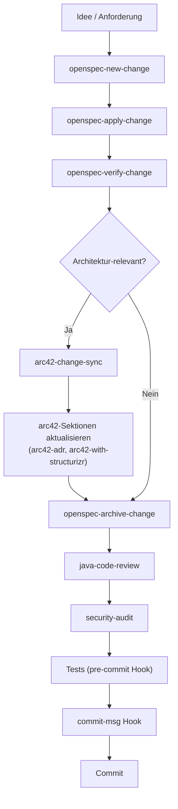

# Projekt A: Agentischer Workflow (Praxisbeispiel)

> **Anonymisiert.** Praxisbeispiel für den Brownfield-Einstieg im KI-Teil (Folie „Projekt A“). Projektname, Kunde und projektspezifische Skill-Namen sind entfernt. Grundlage ist das Workflow-Dokument des Projekts (Version 1.1, Status „In Kraft“). Werkzeug im Projekt: OpenCode mit Skills.

## Überblick

Der Workflow hat drei Phasen. Nicht jeder Change durchläuft alle.

1. **OpenSpec Change-Management:** Änderung von der Idee bis zum Archiv
2. **arc42-Dokumentation:** bei architekturrelevanten Changes nachziehen
3. **Qualitätssicherung und Commit:** Code Review, Security Audit, Tests, Commit



## Phase 1: OpenSpec Change-Management

| Schritt | Skill | Ziel | Ergebnis |
|---|---|---|---|
| 1 | `openspec-new-change` | Idee in einen strukturierten Change überführen: Proposal (Why, What Changes, Capabilities, Impact), dann Specs, Design, Tasks | Change-Ordner `openspec/changes/<name>/` |
| 2 | `openspec-apply-change` | Tasks aus `tasks.md` abarbeiten, jede Implementierung committen | umgesetzte Änderung |
| 3 | `openspec-verify-change` | Prüfung in drei Dimensionen: Completeness, Correctness, Coherence. Report mit CRITICAL / WARNING / SUGGESTION | „Ready for archive“ oder offene Punkte |
| 4 | `openspec-archive-change` | Warnungen prüfen, Delta-Specs optional syncen, Change archivieren | `openspec/changes/archive/YYYY-MM-DD-<name>/` |

Nach dem Verify-Report entscheidet der Entwickler bzw. die Entwicklerin, ob Phase 2 nötig ist.

## Phase 2: arc42-Dokumentation synchronisieren

Optional, nur bei architekturrelevanten Changes. Der Skill `arc42-change-sync` läuft **nicht automatisch**, sondern wird nach dem Verify-Report bewusst geladen.

**Entscheidungsmatrix (Kurzfassung):**

- **Architekturrelevant (Update nötig):** neue Module, Schnittstellen, externe Systeme, Deployment-Änderungen, neue Querschnittskonzepte, sicherheitsrelevante Änderungen, neue ADRs
- **Nicht relevant (kein Update):** reine Bugfixes, interne Refactorings, UI-Änderungen, Konfigurationsänderungen

**Ablauf:**

1. **Change analysieren:** Proposal, Tasks und Specs lesen, betroffene arc42-Sektionen bestimmen, Report mit Handlungsbedarf
2. **Aktualisieren** (nach Bestätigung):
   - einfache Änderungen direkt in der betroffenen `.adoc`-Datei
   - neue ADRs mit `arc42-adr`: Nygard-Format, eine Markdown-Datei pro Entscheidung, Sektion 9 als Übersicht
   - Diagramme mit `arc42-with-structurizr`

Der Skill prüft außerdem, ob `design.md` Entscheidungen enthält, für die es noch kein ADR gibt, und bietet an, sie zu erfassen.

**Ablage der arc42-Doku:**

```
docs/architecture/
├── arc42-konzept.adoc          Hauptdokument
├── adr/                        ADRs (Nygard, Markdown), eine Datei pro Entscheidung
├── sections/                   01-…12-*.adoc, Sektion 9 als Decision Log
└── diagrams/
    ├── structurizr/            DSL-Quellen
    ├── *.puml                  exportiertes PlantUML
    └── *.svg                   gerenderte Diagramme
```

Doku auf Deutsch, Fachbegriffe und Bezeichner bleiben englisch.

## Phase 3: Qualitätssicherung und Commit

| Schritt | Was | Blockiert bei |
|---|---|---|
| 1 | `java-code-review`: Null-Sicherheit, Exceptions, Concurrency, Performance. Weist nur hin, ändert nichts | – |
| 2 | `security-audit`: OWASP Top 10, Input-Validierung, Injection | – |
| 3 | `pre-commit` Hook: Tests | Testfehler |
| 4 | `commit-msg` Hook: Conventional Commits auf Deutsch | ungültiges Format |

Format: `<type>(<scope>): <kurze beschreibung>`, z. B. `docs(arc42): Deployment-View aktualisiert`.

## Skills im Projekt

| Skill | Phase |
|---|---|
| `openspec-new-change`, `-apply-change`, `-verify-change`, `-archive-change`, `-sync-specs` | OpenSpec |
| `arc42-change-sync`, `arc42-adr`, `arc42-with-structurizr`, `arc42-section-NN` | arc42 |
| `java-code-review`, `security-audit` | Qualität |
| projektspezifisch: Modul-Scaffolding, Merge-Request-Beschreibung | Sonstiges |

## Was das Beispiel im Training zeigt

- Doku-Pflege ist **Teil des Change-Ablaufs**, nicht ein eigenes Projekt.
- Ein Mensch entscheidet, ob ein Change architekturrelevant ist. Die Matrix hilft dabei.
- Dieselben Skills wie im Training (`arc42-change-sync`, `arc42-adr`, `arc42-with-structurizr`) laufen im Projekt produktiv.
