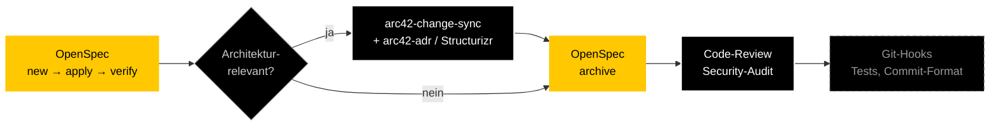
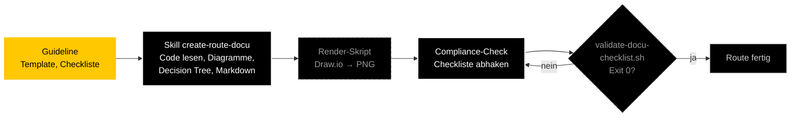
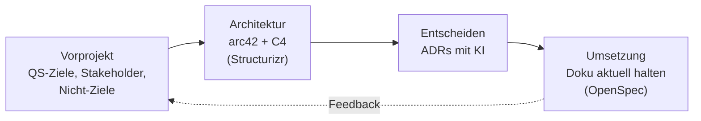
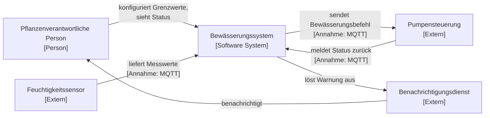
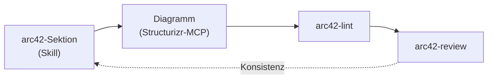
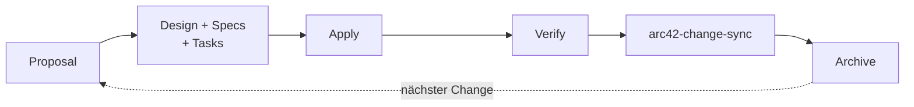
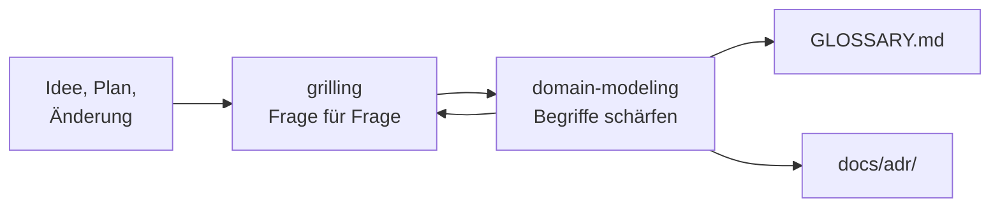

# Dokumentation mit KI

## Technische Dokumentation und Kommunikation

Mattias Fankhauser

Tag 2 · 27.11.2026

<!--
Moderation: Termin 27.11.2026, Start 9:30 oder 10:00 (Zeiten siehe Agenda-Notiz).
Rahmen: Gestern ging es darum, was gute Architekturdokumentation ausmacht. Heute legen wir eine KI-Schicht darüber.
-->

---
layout: agenda
---

# Agenda

- Dein IST- und Wunschstand
- Aus der Praxis
- Einordnung
- Vier Phasen mit KI
- Transfer und Muster

<!--
Moderation: Ca. 3:45 h inkl. zwei Pausen. Erst Praxis, dann Theorie – bewusst so herum.

Gruppe am Anfang fragen: Wollen wir gemeinsam Mittagessen gehen, oder lieber zwei kurze Pausen und dafür früher nach Hause? Mit Mittagspause verschieben sich die Zeiten unten entsprechend.

| 9:30 | 10:00 | Block | min |
|---|---|---|---|
| 9:30 | 10:00 | Einstieg: Rahmen 5, IST-/Wunschstand schreiben 15, gemeinsam clustern 10 | 30 |
| 10:00 | 10:30 | Aus der Praxis: Projekt A, Projekt B, gemeinsames Muster | 30 |
| 10:30 | 11:00 | Einordnung | 10 |
| 10:40 | 11:10 | **Pause** | 15 |
| 10:55 | 11:25 | Phase 1 Vorprojekt | 15 |
| 11:10 | 11:40 | Phase 2 Architektur (Live-Demo Zoo) | 40 |
| 11:50 | 12:20 | **Pause** | 15 |
| 12:05 | 12:35 | Phase 3 Entscheiden | 15 |
| 12:20 | 12:50 | Phase 4 Umsetzung | 15 |
| 12:35 | 13:05 | Transfer | 25 |
| 13:00 | 13:30 | Puffer | 15 |
| 13:15 | 13:45 | **Ende** |  |
-->

---

# Dein IST- und Wunschstand

**15 Minuten allein schreiben · dann 10 Minuten gemeinsam clustern**

- **IST:** Wie dokumentierst du heute? Womit, wann, für wen?
- **Wunsch:** Wie willst du dokumentieren?
- **KI:** Wo hilft sie dir heute schon – und wo nicht?

Eine Karte pro Frage. Danach clustern wir gemeinsam – die Cluster begleiten uns durch den Tag.

<!--
Moderation: 30 min. TKuD-Vorgabe – jede:r schreibt IST- und Wunschstand nieder, um Muster zu finden.
Ablauf: Rahmen und Agenda (5), still auf Karten schreiben, je eine Karte IST, Wunsch, KI (15),
gemeinsam clustern: alle schieben gleichzeitig und still Karten zusammen (5), dann Cluster benennen (5).
Keine Einzelvorstellung – bei 12 Personen zu lang.
Cluster bleiben den Tag über sichtbar; in den Blöcken darauf verweisen („euer Cluster ‚Doku veraltet‘ – hier hilft Phase 4“).
Besprechung und Optimierung im Transfer am Ende.
OFFEN: physisch an der Wand oder digital (Miro o. Ä.)?
-->

---
layout: section
---

# Aus der Praxis

## Brownfield: Doku aus bestehendem Code

---

# Projekt A: arc42 aus Legacy-Code

- **Ausgangslage:** Bestandssystem wird modernisiert, arc42 liegt als AsciiDoc im Repo
- **KI-Einsatz:** agentischer Workflow mit Skills – jeder Change läuft durch OpenSpec, architekturrelevante Changes ziehen arc42 nach
- **Ergebnis:** ADRs pro Entscheidung, Diagramme aus Structurizr, Doku wächst mit jedem Change

<!--
Moderation: 15 min. Intern: Media Data. Auf den Folien anonymisiert (Entscheidung 16.10.).
Quelle: documents/ai/projekt-a-workflow.md (anonymisiert).
TODO: konkrete Ergebnisse/Zahlen (Anzahl ADRs, Sektionen, Erfahrungen) und anonymisierte Ausschnitte ergänzen.
-->

---

# Projekt A: Der Workflow



<div class="legend">
  <span><i class="sw sw-openspec"></i>OpenSpec-Skills</span>
  <span><i class="sw sw-agent"></i>weitere Skills (agentisch)</span>
  <span><i class="sw sw-human"></i>Entscheidung Mensch</span>
  <span><i class="sw sw-auto"></i>automatisch, ohne KI</span>
</div>

<style>
.legend { display: flex; gap: 1.6rem; flex-wrap: wrap; font-size: var(--gepardec-text-xs); margin: 0.4rem 0 0.8rem; }
.legend span { display: inline-flex; align-items: center; gap: 0.45rem; }
.legend .sw { display: inline-block; width: 1.1rem; height: 0.8rem; background: #000; }
.legend .sw-openspec { background: #FFC800; border: 1px solid #FFC800; }
.legend .sw-agent { border: 2px solid #fff; }
.legend .sw-human { border: 1px solid #999; width: 0.8rem; transform: rotate(45deg); }
.legend .sw-auto { border: 1px dashed #666; }
</style>

- Ein Mensch entscheidet, ob arc42 betroffen ist – mit Entscheidungsmatrix
- Bugfix, Refactoring, UI: kein Update. Neues Modul, Schnittstelle, Deployment: Update

<!--
Moderation: Werkzeug im Projekt: OpenCode. Dieselben Skills wie heute im Training.
Matrix im Detail: documents/ai/projekt-a-workflow.md.
-->

---

# Projekt B: Camel-Route-Guideline

- **Ausgangslage:** viele Integrationsrouten (Camel/Quarkus), Wissen steckt im Code
- **KI-Einsatz:** Agent dokumentiert Route für Route nach einer verbindlichen Guideline – per Skill oder mit Sub-Agents fürs ganze Repo
- **Ergebnis:** pro Route Markdown, zwei Draw.io-Diagramme und eine abgehakte Checkliste

<!--
Moderation: 10 min. Intern: MM. Auf den Folien anonymisiert (Entscheidung 16.10.).
Quelle: documents/ai/projekt-b-workflow.md (Handoff aus dem Projekt, dort schon anonymisiert).
Kernpunkte: Guideline gewinnt bei Widersprüchen. Nichts wird still erfunden – Lücken <TBD>, synthetische Beispiele <GENERATED>.
TODO: anonymisierten Ausschnitt einer echten Route-Doku (Decision Tree oder Diagramm) zeigen.
-->

---

# Projekt B: Der Workflow



<div class="legend">
  <span><i class="sw sw-rule"></i>verbindliche Vorgaben</span>
  <span><i class="sw sw-agent"></i>Agent (Skill)</span>
  <span><i class="sw sw-auto"></i>automatisch, ohne KI</span>
</div>

- Fertig heißt **geschrieben und geprüft** – Checkliste plus Skript-Gate
- Ganzes Repo: Orchestrator gibt jeder Route einen eigenen Sub-Agent

<style>
.legend { display: flex; gap: 1.6rem; flex-wrap: wrap; font-size: var(--gepardec-text-xs); margin: 0.4rem 0 0.8rem; }
.legend span { display: inline-flex; align-items: center; gap: 0.45rem; }
.legend .sw { display: inline-block; width: 1.1rem; height: 0.8rem; background: #000; }
.legend .sw-rule { background: #FFC800; border: 1px solid #FFC800; }
.legend .sw-agent { border: 2px solid #fff; }
.legend .sw-auto { border: 1px dashed #666; }
</style>

<!--
Moderation: Single-Route-Ablauf hat 8 Schritte (Analyse, Diagramme, Decision Tree, Markdown, Dateien, Compliance, Skript, Report) – hier verdichtet.
Orchestrator: Discover (NEW/STALE/SKIP) → 1 Route = 1 Sub-Agent → Reports sammeln → Gesamtbericht FAIL → TBD → PASS.
Vergleich zu Projekt A: dort OpenSpec pro Change, hier Guideline pro Route. Beide: Mensch setzt den Standard, Agent arbeitet ihn ab, Prüfung entscheidet über „fertig“.
-->

---
class: gepardec-text-sm
---

# Das gemeinsame Muster

**Mensch** setzt den Standard → **Agent** arbeitet ihn ab → **Gate** entscheidet: fertig?

| | Standard | Agent | Gate |
|---|---|---|---|
| Projekt A | OpenSpec-Change, Entscheidungsmatrix | Skills pro Schritt | Verify, Review, Git-Hooks |
| Projekt B | Guideline, Template, Checkliste | Skill pro Route | Checkliste + Skript |

<!--
Moderation: Brücke von der Praxis zur Theorie. Diese drei Rollen tragen durch den ganzen Block:
Ohne Standard schreibt der Agent generisch. Ohne Gate weiß niemand, ob es stimmt. Die Entscheidungen bleiben beim Menschen.
Später auf der Folie „Typische Fehler in KI-Doku“ wieder aufgreifen: Prüfen geht nur gegen eine Referenz.
-->

---
layout: section
---

# Einordnung

## Phasen, Einstiege, Bausteine

---
layout: statement
---

# KI bringt keine neuen Konzepte. **Sie legt eine Schicht über das, was du gestern gelernt hast.**

<!--
Moderation: Sichten/C4, arc42, ADRs bleiben gleich. KI stellt Fragen, strukturiert, leitet ab, prüft – Entscheidungen bleiben bei uns.
Was rauskommt, ist nur so gut wie der Input und wird genauso kritisch gelesen wie menschliche Doku.
-->

---

# Vier Phasen



Jede Phase greift auf ein Kapitel von gestern zurück.

<!--
Moderation: Rückbezüge – Vorprojekt → Kreuztabelle (ADR-Kapitel), Architektur → Sichtenmodell und Notation, Entscheiden → ADR-Kapitel, Umsetzung → Docs-as-Code / Review-Prozess.
-->

---

# Zwei Einstiege

| | Greenfield | Brownfield |
|---|---|---|
| Quelle | Gespräche, Anforderungen, Ideen | Code, Konfiguration, Git-Historie |
| Rolle der KI | Sparringspartner: fragt nach | Analyst: leitet ab |
| Hauptrisiko | generisch, „alles ist wichtig“ | halluzinierte Zusammenhänge |
| ADRs | festhalten, während sie fallen | Gründe rekonstruieren |
| Heute | gezeigt (Phase 1, Pflanzenbewässerung) | gezeigt (Praxis, Zoo-Demo) |

<!--
Moderation: Greenfield läuft Vorprojekt → Umsetzung, Brownfield startet bei der Umsetzung (Code als Quelle) und arbeitet sich zurück. Beide münden in denselben Zyklus: Doku aktuell halten.
-->

---
layout: two-cols-header
---

# Doku hat jetzt zwei Leser

::left::

### Menschen
- arc42, ADRs, Diagramme
- Wollen verstehen und entscheiden
- Lesen selten, dann gezielt

::right::

### Agenten
- `AGENTS.md` / `CLAUDE.md`, Guidelines, Skills
- Wollen wissen: Regeln, Ablauf, wo liegt was
- Lesen bei **jeder** Aufgabe, wörtlich

::bottom::

Die Frage von gestern bleibt: **Wer liest das, und was braucht er:sie?**

<!--
Moderation: Rückbezug Tag 1 (Zielgruppen, Informationsbedürfnisse). Agenten sind eine neue Zielgruppe mit eigenen Bedürfnissen:
eindeutig, vollständig, ohne implizites Wissen. Was für Agenten klar geschrieben ist, hilft oft auch neuen Teammitgliedern.
Beispiele: Projekt A hat eine AGENTS.md mit Build-, Test-, Logging- und Commit-Regeln. Projekt B macht die Guideline verbindlich – bei Widerspruch gewinnt sie.
Frage an die Runde: Was steht bei euch nur in Köpfen, das ein Agent wissen müsste?
-->

---
layout: quadrants
---

# Die Bausteine

::one::

### Agent
Junie, Claude usw. Alle Demos laufen damit.

::two::

### Skills
Wiederverwendbare Anleitungen für den Agenten, z. B. grill-me oder arc42-Sektionen.

::three::

### MCP-Server
Bindet externe Werkzeuge an, z. B. Structurizr zum Validieren und Rendern.

::four::

### Spec-driven
Spezifikation, Umsetzung und Doku entstehen in einem Zyklus.

<!--
Moderation: Konzepte sind werkzeugneutral – die Agenten sind ein Beispiel, keine Voraussetzung.
-->

---
layout: quadrants
---

# Nützliche Skills

::one::

### grilling / grill-me
Fragt dich zu Plan oder Entscheidung aus, Ast für Ast, bis alles geklärt ist. Pro Frage eine Empfehlung.

[mattpocock/skills: grilling](https://github.com/mattpocock/skills/tree/main/skills/productivity/grilling) · [grill-me](https://github.com/mattpocock/skills/tree/main/skills/productivity/grill-me)

::two::

### grill-with-docs
grilling plus domain-modeling: Während des Interviews entstehen ADRs und Glossar.

[mattpocock/skills: grill-with-docs](https://github.com/mattpocock/skills/tree/main/skills/engineering/grill-with-docs)

::three::

### domain-modeling
Schärft Fachbegriffe, deckt Widersprüche auf und pflegt `GLOSSARY.md`.

[mattpocock/skills: domain-modeling](https://github.com/mattpocock/skills/tree/main/skills/engineering/domain-modeling)

::four::

### arc42-adr / arc42-change-sync
ADRs im schlanken Format von gestern plus arc42-Sektion 9. Nach einem Change die arc42-Doku nachziehen.

Eigene Skills: `.junie/skills/arc42-adr`, `.junie/skills/arc42-change-sync`

<!--
Moderation: Quellen der Skills im Trainings-Repo:
- Alle fünf liegen in .claude/skills/ (Claude) und .junie/skills/ (Junie), jeweils ein Ordner echt, der andere Symlink. Junie liest .claude/skills/ nicht.
- grill-me, grilling, domain-modeling, grill-with-docs: mattpocock/skills
- arc42-adr, arc42-change-sync: eigene Skills
- Weitere: arc42-Sektionen von https://github.com/MSiccDev/arc42-toolkit, u. a. arc42-section-01/-10 für Phase 1. Alternative: Brainstorming von https://github.com/obra/superpowers/tree/main/skills/brainstorming
grill-me ist die Variante ohne Doku, grill-with-docs ruft grilling und domain-modeling zusammen auf.
arc42-change-sync hängt zwischen openspec-verify und openspec-archive.
-->

---
layout: section
---

# Phase 1

## Vorprojekt

---

# Die KI stellt die unbequemen Fragen

- Welche **Qualitätsziele** zählen wirklich? Top 3, nicht zehn.
- Woran messen wir die **nicht-funktionalen Anforderungen**?
- Wer sind die **Stakeholder** – und was brauchen sie von der Doku?
- Was bauen wir ausdrücklich **nicht**?

Werkzeug: **grill-me** für die Fragen, **arc42-section-01 / -10** für das Ergebnis

<!--
Moderation: 20 min inkl. Live-Demo grill-me am Demo-Projekt.
grill-me klärt Qualitätsziele, Stakeholder und Nicht-Ziele im Interview. arc42-section-01 schreibt daraus Sektion 1 (Ziele, Stakeholder), arc42-section-10 macht die Qualitätsziele zu messbaren Szenarien und hakt bei vagen Metriken nach. Randbedingungen bei Bedarf mit arc42-section-02.
Die arc42-Sektions-Skills liegen nur unter .junie/skills (arc42-toolkit), grill-me in beiden Ordnern.
Alternative: Brainstorming-Skill aus obra/superpowers (Plugin, nicht im Repo).
Ergebnisse fließen in arc42-Sektion 1, 2 und 10 und später in die Kreuztabelle.
-->

---
layout: section
---

# Phase 2

## Architektur

---

# Live-Demo: Zoo-Verwaltung dokumentieren

- Bestehende App aus der OpenSpec-Schulung: Angular + Quarkus, **keine Architekturdoku**
- Ein Prompt: vollständige arc42-Doku mit C4-Sichten, abgeleitet aus dem Code
- Der Agent arbeitet ohne Rückfragen, Lücken markiert er als **Annahme**
- Während er läuft: die Werkzeuge, die er dabei benutzt
- Demo-Repo: [github.com/Gepardec/openspec-quarkus-angular](https://github.com/Gepardec/openspec-quarkus-angular)

<!--
Moderation: 3 min. Demo gleich zu Beginn starten, das Ergebnis kommt nach Structurizr, arc42-Toolkit und Orchestrierung (ca. 20 min Laufzeit).

Vorbereitung (vor dem Training):
- Zoo-Repo ~/IdeaProjects/openspec-quarkus-angular: `git switch -C live-demo arc42-live-start` (Tag auf Commit 6898c74: Skills und Structurizr-MCP da, noch keine Doku; `-C` setzt den Branch nach der Probe zurück). Danach `git status` und `git clean -n docs/`: Reste aus der Probe löschen, sonst startet der Agent auf vorhandener Doku
- `which plantuml` prüfen, Structurizr-MCP verbunden (`/mcp`)
- Claude Code so starten, dass Edits, `plantuml` und vom Agenten angelegte Render-Skripte ohne Freigabe laufen (`render.sh` gibt es am Startpunkt noch nicht). Genaue Einstellung in der Probe festlegen und hier eintragen. TODO
- Fallback: fertiges Ergebnis von Branch `arc42` als Worktree in einem zweiten IDE-Fenster öffnen (`git worktree add ../zoo-arc42 arc42`), im Demo-Checkout läuft ja der Agent
- OFFEN: Probelauf mit Zeitmessung. Reichen ca. 20 min nicht, den Umfang im Prompt reduzieren (z. B. Laufzeit- und Verteilungssicht weglassen)

Prompt (so eingeben, auch in demo/prompts/phase2-zoo-arc42.md):

Dokumentiere die Architektur dieser Anwendung vollständig nach arc42. Nutze den Skill arc42-with-structurizr und die arc42-Section-Skills.
- Arbeite ohne Rückfragen, ich bin die nächsten 20 Minuten nicht erreichbar. Was der Code nicht hergibt (Qualitätsziele, Stakeholder, Randbedingungen, Motive hinter Entscheidungen), schreibst du als „Annahme:“ in die Sektion und sammelst es als offene Frage in docs/architecture/README.md.
- Quelle ist nur der Code auf diesem Stand. Offene Changes unter openspec/changes/ sind nicht umgesetzt und gehören nicht in die Doku.
- Alle C4-Sichten (Kontext, Container, Komponenten, Laufzeit, Verteilung) in einem einzigen docs/architecture/diagrams/structurizr/workspace.dsl. Mit dem Structurizr-MCP validieren, als PlantUML exportieren, als SVG rendern und in die Sektionen einbinden.
- Im Code erkennbare Architekturentscheidungen als ADRs mit arc42-adr, Motiv als „rekonstruiert, unbestätigt“ markieren.
- Zum Schluss arc42-lint und arc42-review ausführen und die Befunde auflisten. Nichts mehr nachfragen.
-->

---
layout: two-cols-header
---

# Structurizr: Architektur als Code

::left::

### Ein Modell
- Personen, Systeme, Container, Komponenten
- Beziehungen einmal beschrieben
- Textdatei (DSL), versioniert im Git

::right::

### Viele Sichten
- Kontext, Container, Komponente, Deployment
- Jede Sicht ist ein Ausschnitt des Modells
- Export nach PlantUML, Mermaid, PNG

::bottom::

Ändert sich das Modell, ziehen **alle Sichten** mit. Keine Kopien, die auseinanderlaufen.

[structurizr.com](https://structurizr.com) · [docs.structurizr.com/example](https://docs.structurizr.com/example) · [docs.structurizr.com/dsl](https://docs.structurizr.com/dsl)

<!--
Moderation: Im Browser zeigen (ca. 5 min), Structurizr ist von Simon Brown, dem Autor von C4:
1. Beispiele: https://docs.structurizr.com/example – dieselben Beispieldiagramme wie auf c4model.com, je eine Seite pro Sichttyp. Link „Structurizr DSL source“ öffnet die DSL im Playground (playground.structurizr.com).
2. Setup: https://docs.structurizr.com/getting-started – Varianten von lokal/Docker bis Export nach PlantUML/Mermaid. Wir nutzen: DSL im Repo, Export über den MCP.
3. Interaktives Beispiel: https://c4model.com/example/ (Link „Interactive version“ auf der Beispielseite) – durch die Sichten klicken, Zoom von Kontext bis Komponente.
Die Oberfläche dahinter: Structurizr liest dieselbe workspace.dsl auch im Browser – `local` (früher Lite, Docker, nur localhost), `server` (selbst gehostet fürs Team) oder als statischer Export wie dieses Beispiel. Kann Navigation durch die Sichten, Layout per Drag-and-drop, Doku und ADRs neben dem Modell (`!docs`, `!adrs`). In unserem Workflow nicht nötig: Der Agent exportiert über den MCP nach PlantUML/SVG in die arc42-Sektionen. Lohnt sich, wenn Leser:innen nicht ins Repo schauen.
Rückbezug auf C4 von gestern. Unterschied zu Zeichenwerkzeugen: Diagramme sind Sichten auf ein Modell, nicht einzelne Bilder.
Konsistenz zwischen Sichten (Kapitel „Sichtenmodell und Notation“) ist damit eingebaut.
-->

---
class: gepardec-text-sm
---

# Structurizr-MCP

Der Agent schreibt die DSL und **prüft sie selbst**:

- `validate` – ist die DSL gültig?
- `parse` / `inspect` – was steckt im Modell, gibt es Auffälligkeiten?
- `export-mermaid` / `export-plantuml` – Sicht rendern

```text
claude mcp add --transport http --scope project structurizr https://mcp.structurizr.com/mcp
```

Schreibt `.mcp.json` ins Repo. Junie liest stattdessen `.junie/mcp/mcp.json`.

<!--
Moderation: Gehosteter Server https://mcp.structurizr.com/mcp, nichts zu installieren. Setup: documents/how-tos/structurizr-setup.md.
Befehl für Claude Code; --scope project schreibt .mcp.json (im Team einchecken), --scope user gilt für alle eigenen Projekte. Junie: Eintrag in .junie/mcp/mcp.json bzw. Settings → Tools → Junie → MCP Settings (documents/how-tos/junie-setup.md).
Hinweis Vertraulichkeit: Der gehostete Server bekommt die DSL. Für Kundenmodelle lokal per Docker betreiben.
Kurz ins Terminal der Live-Demo schauen: Ruft der Agent schon validate auf?
-->

---
class: gepardec-text-sm
---

# Greenfield: Pflanzenbewässerung

```text
!identifiers hierarchical
model {
  verantwortliche = person "Pflanzenverantwortliche Person"
  bewaesserung = softwareSystem "Bewässerungssystem" {
    app    = container "Web-App"
    dienst = container "Bewässerungsdienst"
  }
  sensor = softwareSystem "Feuchtigkeitssensor"
  sensor -> bewaesserung.dienst "liefert Messwerte"
  // … weitere Container, Systeme, Beziehungen
}
views {
  systemContext bewaesserung "Kontext" { include * }
  container bewaesserung "Container" { include * }
}
```

Auszug aus `demo/structurizr/workspace.dsl`. In IntelliJ zeigt das Plugin [Structurizr DSL](https://plugins.jetbrains.com/plugin/29351-structurizr-dsl) Kontext- und Containersicht live neben dem Code.

<!--
Moderation: Das fiktive System von gestern, Greenfield: Das Modell entsteht aus dem Brief, nicht aus Code. Technologien sind im Workspace als „Annahme:“ markiert.
Wird nicht live erzeugt, sondern vorgestellt. Kontrast zur laufenden Zoo-Demo: dort Brownfield aus dem Code.
Auf der Folie gekürzt (Beschreibungen, Technologien, weitere Beziehungen, Styles fehlen). Zeigen: demo/structurizr/workspace.dsl in IntelliJ öffnen, Plugin „Structurizr DSL“ (Jakub Jirák) → Split Editor mit Live-Vorschau, zwischen den Sichten „Kontext“ und „Container“ umschalten. Ein Modell, zwei Sichten – eine Beziehung im Code ändern, beide Sichten ziehen mit.
-->

---

# Ergebnis: Kontextsicht



<!--
Moderation: Erzeugt über export-mermaid aus dem Workspace (Styling und Beschreibungen fürs Theme entfernt, Technologien als „Annahme:“ behalten – im Greenfield ist noch nichts entschieden).
Die Containersicht kommt aus demselben Modell.
-->

---
class: gepardec-text-sm
---

# arc42-Toolkit: ein Skill pro Sektion

- Open Source (MIT), werkzeugneutral: Claude Code, Copilot, Cursor, Codex und jedes Werkzeug, das Markdown-Skills liest
- 12 Sektions-Skills plus `arc42-lint` (Querverweise) und `arc42-review` (Inhalt)
- Fragt zuerst nach, statt zu erfinden; Tiefe wählbar: LEAN, ESSENTIAL, THOROUGH
- Qualitätsmodell Q42 eingebaut, Diagramme in C4
- [github.com/MSiccDev/arc42-toolkit](https://github.com/MSiccDev/arc42-toolkit)

```text
/plugin marketplace add MSiccDev/arc42-toolkit
/plugin install arc42-toolkit@arc42-toolkit
```

<!--
Moderation: GitHub-Seite zeigen (README, Ordner skills/). Empfehlung des Toolkits: mit Sektion 1.2 Qualitätsziele anfangen.
Befehle für Claude Code. Für Junie siehe documents/how-tos/junie-setup.md (Junie-Spike archiviert, Frischklon-Test und Junie-Version noch offen), im Demo-Repo liegen die Skills schon unter .junie/skills/ bzw. .agents/skills/.
Team-Variante: Plugin per .claude/settings.json im Projekt festlegen.
Toolkit-Diagramme sind eigene PlantUML-Dateien. In unserem Workflow kommen alle C4-Sichten stattdessen aus einem Structurizr-Workspace (nächste Folie).
Brücke zur Live-Demo: „Fragt zuerst“ haben wir dort per Prompt abgeschaltet. Was er gefragt hätte, steht gleich als Annahme im Ergebnis.
-->

---

# Orchestrierung: arc42-with-structurizr



Unser eigener Skill verbindet Text, Diagramm und Prüfung. **Genau das läuft gerade im Zoo-Repo.**

<!--
Moderation: Rückbezug Kapitel „Sichtenmodell und Notation“ – Konsistenz zwischen Sichten, Level of Detail.
Danach zum Terminal der Live-Demo wechseln.
-->

---

# Ergebnis: Zoo-Verwaltung (Brownfield)

- Was ist entstanden: Sektionen, ein `workspace.dsl`, gerenderte Sichten, ADRs
- **Annahmen** und offene Fragen: das hätte das Toolkit dich gefragt
- Befunde aus `arc42-lint` und `arc42-review`
- Gegenprobe gegen den Code: Was hat der Agent falsch abgeleitet?

<!--
Moderation: 10 min. Reihenfolge: docs/architecture/README.md (Übersicht, offene Fragen) → Sektion 3 und 5 mit SVGs → workspace.dsl (ein Modell, alle Sichten) → ADRs → Lint-/Review-Befunde.
Fokus Annahmen: Qualitätsziele und Stakeholder stehen nicht im Code. Genau dafür gibt es Phase 1, der Agent kann sie nur raten.
Befunde, die nur der Code liefert (aus der Doku auf Branch arc42, nicht aus einem Lauf dieses Prompts): Gehege ist keine Entity, keine Service-Schicht, AGENTS.md nennt Personal, das es nicht gibt.
Fehlableitungen nicht still korrigieren, sondern zeigen (typisch: Gehege als eigene Entity, SPA und API als ein Container). Brücke zur Folie „Typische Fehler in KI-Doku“.
Noch nicht fertig? Zwischenstand zeigen, Rest im Worktree von Branch arc42 (Fallback). Phase 3 und 4 arbeiten ohnehin auf den Branches arc42 und arc42-unique-names weiter.
-->

---
layout: statement
---

# Der Code zeigt, was gebaut wurde – nicht, worauf es ankommt. **Qualitätsziele sind Entscheidungen, keine Ableitungen.**

<!--
Moderation: Direkt nach dem Zoo-Ergebnis, 1 min. Im Ergebnis stehen Qualitätsziele und Stakeholder nur als „Annahme:“ – der Agent kann sie aus dem Code nicht ableiten, nur raten. Rückbezug auf Phase 1: Dort entscheidet der Mensch, die KI stellt nur die Fragen.
-->

---
class: gepardec-text-sm
---

# Welches Diagramm-Werkzeug?

| | Structurizr | Draw&#46;io | Mermaid |
|---|---|---|---|
| Was es ist | Modell, Sichten daraus | Bild, frei gezeichnet | Diagramm aus Text |
| Agent kann | schreiben, validieren, rendern | XML schreiben, Skript rendert PNG | schreiben, rendert fast überall |
| Stärke | Konsistenz über Sichten | volle Layout-Kontrolle | einfach, im Git und Wiki sichtbar |
| Schwäche | nur C4, eigenes Werkzeug | XML schwer zu reviewen | wenig Layout-Kontrolle |
| Beispiel | Projekt A, Demo heute | Projekt B | diese Folien |

Welche Notation passt zu **euren Lesern** und **eurem Änderungsrhythmus**?

<!--
Moderation: Rückbezug Tag 1 (Notationen wählen nach Zweck). Projekt B hat Mermaid bewusst ausgeschlossen und eine feste Draw.io-Palette in der Guideline festgelegt – Lesbarkeit im Wiki ging vor.
Projekt A rendert aus Structurizr-DSL nach PlantUML/SVG. Kein Werkzeug ist „richtig“; wichtig ist, dass die Wahl festgehalten wird (ADR!).
Diskussionsfrage 3–5 min.
-->

---
class: gepardec-text-sm
---

# Typische Fehler in KI-Doku

Beispiele aus einem KI-Entwurf zur Pflanzenbewässerung:

| Fehlerart | Beispiel | Woran erkennbar |
|---|---|---|
| Generik | Qualitätsziele „performant, sicher“ | passt auf jedes System |
| Kein Projektbezug | Stakeholder „Management“ | sagt nichts über *diese* Doku |
| Widerspruch | Sensor steuert Pumpe direkt | Modell: über Bewässerungsdienst |
| Halluzination | Wetterdienst-API | steht in keiner Quelle |
| Annahme als Fakt | MQTT, HiveMQ, Keycloak | im Fall bewusst offen |
| Lücke | Benachrichtigung fehlt | steht im Modell |

Prüfen geht nur **gegen eine Referenz** – deshalb braucht jeder Workflow ein Gate.

<!--
Moderation: 5 min. Beispiele stammen aus einem KI-generierten arc42-Auszug (demo/uebung-kritisch-pruefen/arc42-auszug.md, Details in LOESUNG.md).
Erfahrung: Gegen demo/structurizr/workspace.dsl findet der Agent Widerspruch, Halluzination und Lücke zuverlässig, Generik und fehlenden Projektbezug nur auf ausdrückliche Nachfrage.
Brücke zur Zoo-Demo: Dort sind „Gehege als Entity“ oder „SPA und API als ein Container“ die typischen Fehlableitungen.
Rückbezug auf „Das gemeinsame Muster“: Standard → Agent → Gate.
-->

---
layout: section
---

# Phase 3

## Entscheiden

---
class: gepardec-text-sm
---

# ADRs: Format, Skills, Werkzeuge

- **ADR:** eine Entscheidung pro Datei – Kontext, Entscheidung, Konsequenzen. Ändert sie sich, gibt es ein neues ADR („Superseded by“)
- **Formate:** Nygard (minimal) oder MADR (mit Optionen, Pro und Contra). **Wir nutzen das schlanke Format von gestern:** Nygard plus Alternativen und Bezüge
- **Skills:** `arc42-adr` (schlankes Format, pflegt Sektion 9), `arc42-section-09` aus dem Toolkit, `grill-with-docs` (ADRs entstehen im Interview)
- **Kein eigener MCP nötig:** ADRs sind Markdown im Repo. Structurizr bindet sie per `!adrs` ins Modell ein
- [adr.github.io](https://adr.github.io/) · [MADR](https://adr.github.io/madr/) · [Nygard 2011](https://cognitect.com/blog/2011/11/15/documenting-architecture-decisions) · [Structurizr `!adrs`](https://docs.structurizr.com/dsl/adrs)

<!--
Moderation: 3–5 min, Rückbezug auf das ADR-Kapitel von gestern (MADR, Kreuztabelle).
Nygard vs. MADR: Das schlanke Format liegt dazwischen – Nygard-Kern, Alternativen wie bei MADR, dazu „Bezüge“ zu Qualitätszielen, Risiken und anderen ADRs (speist die Kreuztabelle). Der Skill arc42-adr schreibt genau dieses Format. MADR lohnt sich, wenn Optionen ausführlich mit Entscheidungstreibern verglichen werden sollen. Welches Format, ist selbst eine Entscheidung – im Projekt einmal festlegen.
ADRs sind unveränderlich: Status Proposed → Accepted → Superseded/Deprecated. Der Agent darf alte ADRs nicht umschreiben, sondern legt ein neues an (steht so im Skill).
Structurizr !adrs erwartet standardmäßig das adr-tools-Format; MADR geht über einen eigenen Importer. Sammlung von Vorlagen und Beispielen: github.com/joelparkerhenderson/architecture-decision-record.
-->

---
layout: two-cols-header
---

# ADRs mit KI

::left::

### Greenfield
- Entscheidung festhalten, während sie fällt
- Optionen und Konsequenzen einfordern
- Bezug zu einem Qualitätsziel

::right::

### Brownfield
- „Warum ist das so?“ aus Code und Historie
- Gründe rekonstruieren, nicht erfinden
- Annahmen sichtbar markieren

::bottom::

Format wie gestern: schlankes ADR. Verknüpfung über „Bezüge“ und die Kreuztabelle.

<!--
Moderation: 10 min. Rückbezug ADR-Kapitel (schlankes Format, Kreuztabelle QS ↔ Entscheidungen).
Brownfield-Beispiel (schlankes Format aus dem Skill arc42-adr; die ADRs auf Branch arc42 haben noch „Implications“ statt „Bezüge“, gleicher Inhalt): Zoo-Verwaltung, Branch arc42, docs/architecture/adr/ – vier nachträgliche ADRs (H2 in-memory, ein Deployment mit Quinoa, keine Service-Schicht, Sheriff). Wo das Motiv nicht im Code steht, steht „Kontext rekonstruiert, unbestätigt“ – genau das meint „Annahmen sichtbar markieren“.
-->

---
layout: section
---

# Phase 4

## Umsetzung

---

# Workflow 1: OpenSpec



- Doku wird bei jeder Änderung mitgezogen, nicht nachträglich repariert
- Proposal, Design und Archiv wirken wie ein ADR-Log
- `arc42-change-sync` zieht die arc42-Doku vor dem Archivieren nach

<!--
Moderation: Kurze Demo eines Changes aus dem Trainings-Repo von Proposal bis Archiv.
Zoo-Verwaltung, Branch arc42-unique-names: Change unique-animal-names ist umgesetzt (Tests grün), die arc42-Doku aber noch nicht nachgezogen. Live: openspec-verify-change → arc42-change-sync (findet z. B. 409 Conflict und Unique-Constraint, die in Sektion 5/8 fehlen) → openspec-archive-change.
Rückbezug: Docs-as-Code, ADR-Workflow, Review-Prozess.
-->

---

# Workflow 2: grill-with-docs



- Kein Spec-Framework: der Agent interviewt dich, die Doku entsteht nebenbei
- Begriffe landen im Glossar, sobald sie geklärt sind
- Entscheidungen landen als ADR, sobald sie fallen

<!--
Moderation: Leichtgewichtige Alternative, passt auch zu Vorprojekt und Entscheiden.
Live zeigen: grill-with-docs auf eine Frage zur Pflanzenbewässerung ansetzen (z. B. „Was passiert, wenn der Sensor keine Daten liefert?“) und zeigen, wie Glossar und ADR entstehen.
-->

---
class: gepardec-text-sm
---

# Zwei Workflows im Vergleich

| | OpenSpec | grill-with-docs |
|---|---|---|
| Einstieg | Change-Proposal | Gespräch mit dem Agenten |
| Artefakte | Proposal, Design, Specs, Tasks | Glossar, ADRs |
| Stärke | Nachvollziehbar pro Änderung | Leichtgewichtig, schärft das Denken |
| Passt für | Feature-Arbeit im Team | Klärung, Entscheidungen, Fachsprache |
| Werkzeug | CLI + Skills | nur Skills |

Beide halten die Doku aktuell. Welcher passt, hängt vom Projekt ab.

<!--
Moderation: Phase 4 insgesamt 15 min (beide Workflows und Vergleich).
Kombinierbar: grill-with-docs im explore-Schritt vor einem OpenSpec-Proposal.
-->

---

# Transfer aufs eigene Projekt

- Zurück zu euren Clustern: **Welche Phase, welcher Skill passt dazu?**
- Wo ist der größte Nachholbedarf? Fehlt ein Cluster?
- **Dein Wunschstand, überarbeitet:** Was ändert sich nach heute?
- **Dein erster Schritt:** konkret und im Projekt umsetzbar
- Wie passt das zu den Vorgaben im Projekt, z. B. einem Systemarchitekturkonzept?

<!--
Moderation: 25 min, als Diskussion – nicht live mit Kundencode. Umsetzung im Projekt erst nach Abstimmung mit Projekt bzw. Kunden.
Ablauf: Cluster vom Einstieg besprechen – Phase/Skill zuordnen, Nachholbedarf, ggf. umhängen oder ergänzen (10).
Optimieren: jede:r überarbeitet den eigenen Wunschstand und notiert einen konkreten ersten Schritt, wer mag, liest kurz vor (10).
Abschluss (5).
-->

---
layout: contact
name: Mattias Fankhauser
role: Software Architekt
email: mattias.fankhauser@gepardec.com
phone: +43 664 1869 512
photo: /contact_mfankhauser.jpg
---

# Danke!
