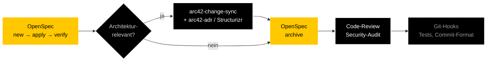
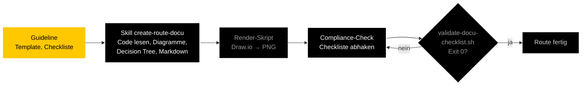
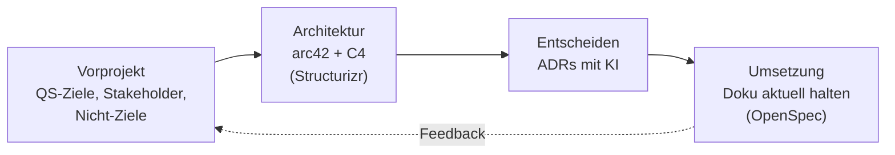
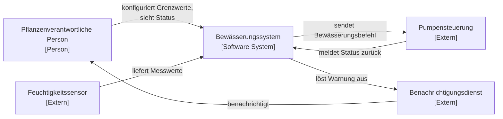
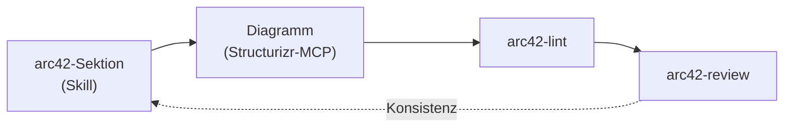
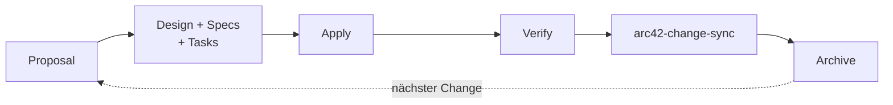
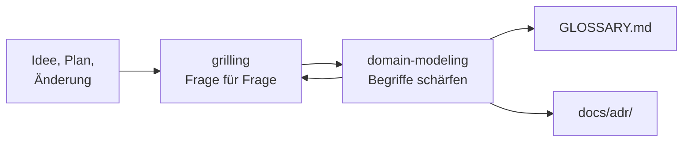

# Dokumentation mit KI

## TKuD · Tag 2

Mattias Fankhauser

<!--
Moderation: Datum ergänzen, sobald Tag 2 fixiert ist.
Rahmen: Gestern ging es darum, was gute Architekturdokumentation ausmacht. Heute legen wir eine KI-Schicht darüber.
-->

---
layout: agenda
---

# Agenda

- Dein IST- und Wunschstand
- Aus der Praxis
- Einordnung
- Vier Phasen mit KI
- Übung: Greenfield-Durchstich
- Transfer und Muster

<!--
Moderation: Ablauf laut Kapitel ca. 3:45 h plus Einstieg IST/Wunsch.
Erst Praxis, dann Theorie – bewusst so herum.
-->

---

# Dein IST- und Wunschstand

**10 Minuten · allein · schriftlich**

- **IST:** Wie dokumentierst du heute? Womit, wann, für wen?
- **Wunsch:** Wie willst du dokumentieren?
- Wo hilft dir KI heute schon – und wo nicht?

Wir sammeln alles und suchen am Ende gemeinsam nach Mustern.

<!--
Moderation: TKuD-Vorgabe – jede:r schreibt IST- und Wunschstand nieder, um später Muster zu finden.
OFFEN: Format (Karten, Board, Datei im Demo-Repo?) und wann genau die Muster ausgewertet werden. Aktuell: Auswertung im Transfer-Block am Ende.
-->

---
layout: section
---

# Aus der Praxis

## Brownfield: Doku aus bestehendem Code

---

# Projekt A: arc42 aus Legacy-Code

- **Ausgangslage:** Bestandssystem wird modernisiert, arc42 liegt als AsciiDoc im Repo
- **KI-Einsatz:** agentischer Workflow mit Skills – jeder Change läuft durch OpenSpec, architekturrelevante Changes ziehen arc42 nach
- **Ergebnis:** ADRs pro Entscheidung, Diagramme aus Structurizr, Doku wächst mit jedem Change

<!--
Moderation: 15 min. Intern: Media Data. Auf den Folien anonymisiert (Entscheidung 16.10.).
Quelle: documents/ai/projekt-a-workflow.md (anonymisiert).
TODO: konkrete Ergebnisse/Zahlen (Anzahl ADRs, Sektionen, Erfahrungen) und anonymisierte Ausschnitte ergänzen.
-->

---

# Projekt A: Der Workflow



<div class="legend">
  <span><i class="sw sw-openspec"></i>OpenSpec-Skills</span>
  <span><i class="sw sw-agent"></i>weitere Skills (agentisch)</span>
  <span><i class="sw sw-human"></i>Entscheidung Mensch</span>
  <span><i class="sw sw-auto"></i>automatisch, ohne KI</span>
</div>

<style>
.legend { display: flex; gap: 1.6rem; flex-wrap: wrap; font-size: var(--gepardec-text-xs); margin: 0.4rem 0 0.8rem; }
.legend span { display: inline-flex; align-items: center; gap: 0.45rem; }
.legend .sw { display: inline-block; width: 1.1rem; height: 0.8rem; background: #000; }
.legend .sw-openspec { background: #FFC800; border: 1px solid #FFC800; }
.legend .sw-agent { border: 2px solid #fff; }
.legend .sw-human { border: 1px solid #999; width: 0.8rem; transform: rotate(45deg); }
.legend .sw-auto { border: 1px dashed #666; }
</style>

- Ein Mensch entscheidet, ob arc42 betroffen ist – mit Entscheidungsmatrix
- Bugfix, Refactoring, UI: kein Update. Neues Modul, Schnittstelle, Deployment: Update

<!--
Moderation: Werkzeug im Projekt: OpenCode. Dieselben Skills wie heute im Training.
Matrix im Detail: documents/ai/projekt-a-workflow.md.
-->

---

# Projekt B: Camel-Route-Guideline

- **Ausgangslage:** viele Integrationsrouten (Camel/Quarkus), Wissen steckt im Code
- **KI-Einsatz:** Agent dokumentiert Route für Route nach einer verbindlichen Guideline – per Skill oder mit Sub-Agents fürs ganze Repo
- **Ergebnis:** pro Route Markdown, zwei Draw.io-Diagramme und eine abgehakte Checkliste

<!--
Moderation: 10 min. Intern: MM. Auf den Folien anonymisiert (Entscheidung 16.10.).
Quelle: documents/ai/projekt-b-workflow.md (Handoff aus dem Projekt, dort schon anonymisiert).
Kernpunkte: Guideline gewinnt bei Widersprüchen. Nichts wird still erfunden – Lücken <TBD>, synthetische Beispiele <GENERATED>.
TODO: anonymisierten Ausschnitt einer echten Route-Doku (Decision Tree oder Diagramm) zeigen.
-->

---

# Projekt B: Der Workflow



<div class="legend">
  <span><i class="sw sw-rule"></i>verbindliche Vorgaben</span>
  <span><i class="sw sw-agent"></i>Agent (Skill)</span>
  <span><i class="sw sw-auto"></i>automatisch, ohne KI</span>
</div>

- Fertig heißt **geschrieben und geprüft** – Checkliste plus Skript-Gate
- Ganzes Repo: Orchestrator gibt jeder Route einen eigenen Sub-Agent

<style>
.legend { display: flex; gap: 1.6rem; flex-wrap: wrap; font-size: var(--gepardec-text-xs); margin: 0.4rem 0 0.8rem; }
.legend span { display: inline-flex; align-items: center; gap: 0.45rem; }
.legend .sw { display: inline-block; width: 1.1rem; height: 0.8rem; background: #000; }
.legend .sw-rule { background: #FFC800; border: 1px solid #FFC800; }
.legend .sw-agent { border: 2px solid #fff; }
.legend .sw-auto { border: 1px dashed #666; }
</style>

<!--
Moderation: Single-Route-Ablauf hat 8 Schritte (Analyse, Diagramme, Decision Tree, Markdown, Dateien, Compliance, Skript, Report) – hier verdichtet.
Orchestrator: Discover (NEW/STALE/SKIP) → 1 Route = 1 Sub-Agent → Reports sammeln → Gesamtbericht FAIL → TBD → PASS.
Vergleich zu Projekt A: dort OpenSpec pro Change, hier Guideline pro Route. Beide: Mensch setzt den Standard, Agent arbeitet ihn ab, Prüfung entscheidet über „fertig“.
-->

---
class: gepardec-text-sm
---

# Das gemeinsame Muster

**Mensch** setzt den Standard → **Agent** arbeitet ihn ab → **Gate** entscheidet: fertig?

| | Standard | Agent | Gate |
|---|---|---|---|
| Projekt A | OpenSpec-Change, Entscheidungsmatrix | Skills pro Schritt | Verify, Review, Git-Hooks |
| Projekt B | Guideline, Template, Checkliste | Skill pro Route | Checkliste + Skript |

<!--
Moderation: Brücke von der Praxis zur Theorie. Diese drei Rollen tragen durch den ganzen Block:
Ohne Standard schreibt der Agent generisch. Ohne Gate weiß niemand, ob es stimmt. Die Entscheidungen bleiben beim Menschen.
Später in der Übung „Finde die Fehler“ wieder aufgreifen: Prüfen geht nur gegen eine Referenz.
-->

---
layout: section
---

# Einordnung

## Phasen, Einstiege, Bausteine

---
layout: statement
---

# KI bringt keine neuen Konzepte. **Sie legt eine Schicht über das, was du gestern gelernt hast.**

<!--
Moderation: Sichten/C4, arc42, ADRs bleiben gleich. KI stellt Fragen, strukturiert, leitet ab, prüft – Entscheidungen bleiben bei uns.
Was rauskommt, ist nur so gut wie der Input und wird genauso kritisch gelesen wie menschliche Doku.
-->

---

# Vier Phasen



Jede Phase greift auf ein Kapitel von gestern zurück.

<!--
Moderation: Rückbezüge – Vorprojekt → Kreuztabelle (ADR-Kapitel), Architektur → Sichtenmodell und Notation, Entscheiden → ADR-Kapitel, Umsetzung → Docs-as-Code / Review-Prozess.
-->

---

# Zwei Einstiege

| | Greenfield | Brownfield |
|---|---|---|
| Quelle | Gespräche, Anforderungen, Ideen | Code, Konfiguration, Git-Historie |
| Rolle der KI | Sparringspartner: fragt nach | Analyst: leitet ab |
| Hauptrisiko | generisch, „alles ist wichtig“ | halluzinierte Zusammenhänge |
| ADRs | festhalten, während sie fallen | Gründe rekonstruieren |
| Heute | selbst gemacht (Übung) | gezeigt (Praxis) |

<!--
Moderation: Greenfield läuft Vorprojekt → Umsetzung, Brownfield startet bei der Umsetzung (Code als Quelle) und arbeitet sich zurück. Beide münden in denselben Zyklus: Doku aktuell halten.
-->

---
layout: two-cols-header
---

# Doku hat jetzt zwei Leser

::left::

### Menschen
- arc42, ADRs, Diagramme
- Wollen verstehen und entscheiden
- Lesen selten, dann gezielt

::right::

### Agenten
- `AGENTS.md` / `CLAUDE.md`, Guidelines, Skills
- Wollen wissen: Regeln, Ablauf, wo liegt was
- Lesen bei **jeder** Aufgabe, wörtlich

::bottom::

Die Frage von gestern bleibt: **Wer liest das, und was braucht er:sie?**

<!--
Moderation: Rückbezug Tag 1 (Zielgruppen, Informationsbedürfnisse). Agenten sind eine neue Zielgruppe mit eigenen Bedürfnissen:
eindeutig, vollständig, ohne implizites Wissen. Was für Agenten klar geschrieben ist, hilft oft auch neuen Teammitgliedern.
Beispiele: Projekt A hat eine AGENTS.md mit Build-, Test-, Logging- und Commit-Regeln. Projekt B macht die Guideline verbindlich – bei Widerspruch gewinnt sie.
Frage an die Runde: Was steht bei euch nur in Köpfen, das ein Agent wissen müsste?
-->

---
layout: quadrants
---

# Die Bausteine

::one::

### Agent
Junie oder Claude. Showcase und alle Übungen laufen damit.

::two::

### Skills
Wiederverwendbare Anleitungen für den Agenten, z. B. Brainstorming oder arc42-Sektionen.

::three::

### MCP-Server
Bindet externe Werkzeuge an, z. B. Structurizr zum Validieren und Rendern.

::four::

### Spec-driven
Spezifikation, Umsetzung und Doku entstehen in einem Zyklus.

<!--
Moderation: Konzepte sind werkzeugneutral – die Agenten sind ein Beispiel, keine Voraussetzung.
-->

---
layout: quadrants
---

# Nützliche Skills

::one::

### grilling / grill-me
Fragt dich zu Plan oder Entscheidung aus, Ast für Ast, bis alles geklärt ist. Pro Frage eine Empfehlung.

[mattpocock/skills: grilling](https://github.com/mattpocock/skills/tree/main/skills/productivity/grilling) · [grill-me](https://github.com/mattpocock/skills/tree/main/skills/productivity/grill-me)

::two::

### grill-with-docs
grilling plus domain-modeling: Während des Interviews entstehen ADRs und Glossar.

[mattpocock/skills: grill-with-docs](https://github.com/mattpocock/skills/tree/main/skills/engineering/grill-with-docs)

::three::

### domain-modeling
Schärft Fachbegriffe, deckt Widersprüche auf und pflegt `GLOSSARY.md`.

[mattpocock/skills: domain-modeling](https://github.com/mattpocock/skills/tree/main/skills/engineering/domain-modeling)

::four::

### arc42-adr / arc42-change-sync
ADRs im Nygard-Format plus arc42-Sektion 9. Nach einem Change die arc42-Doku nachziehen.

Eigene Skills: `.junie/skills/arc42-adr`, `.junie/skills/arc42-change-sync`

<!--
Moderation: Quellen der Skills im Trainings-Repo:
- Alle fünf liegen in .claude/skills/ (Claude) und .junie/skills/ (Junie), jeweils ein Ordner echt, der andere Symlink. Junie liest .claude/skills/ nicht.
- grill-me, grilling, domain-modeling, grill-with-docs: mattpocock/skills
- arc42-adr, arc42-change-sync: eigene Skills
- Weitere: arc42-Sektionen von https://github.com/MSiccDev/arc42-toolkit, Brainstorming von https://github.com/obra/superpowers/tree/main/skills/brainstorming
grill-me ist die Variante ohne Doku, grill-with-docs ruft grilling und domain-modeling zusammen auf.
arc42-change-sync hängt zwischen openspec-verify und openspec-archive.
-->

---
class: gepardec-text-sm
---

# Vertraulichkeit: Was geht wohin?

| Was | Wohin | Regel |
|---|---|---|
| Prompt, Code, Dateien im Kontext | Modell-Anbieter | Nur, wenn Werkzeug und Vertrag für das Projekt freigegeben sind |
| Structurizr-DSL | gehosteter MCP-Server | Nur fiktive oder öffentliche Modelle, sonst lokal per Docker |
| Skills, Guidelines, `AGENTS.md` | Repo | Wie Code behandeln: versioniert, reviewt, keine Secrets |
| Beispieldaten in der Doku | Repo, Wiki | Anonymisieren, Secrets als `<REDACTED>` oder `${env:VAR}` |

**Heute:** nur das Demo-Repo, kein Kundencode, Transfer als Diskussion.

<!--
Moderation: Der Agent schickt alles, was er liest, an den Modell-Anbieter – nicht nur den Prompt. Also: Was liegt im Repo, was öffnet er?
Vor dem Einsatz im Projekt klären: Ist das Werkzeug vom Kunden freigegeben? Welche Daten verlassen das Netz? Wird protokolliert oder trainiert?
Projekt B regelt das in der Guideline selbst: keine Credentials, Beispieldaten anonymisiert.
OFFEN: Verweis auf die interne KI-Richtlinie bzw. freigegebene Werkzeuge ergänzen. Demo-Repo-URL einblenden, sobald sie feststeht.
-->

---
layout: section
---

# Phase 1

## Vorprojekt

---

# Die KI stellt die unbequemen Fragen

- Welche **Qualitätsziele** zählen wirklich? Top 3, nicht zehn.
- Woran messen wir die **nicht-funktionalen Anforderungen**?
- Wer sind die **Stakeholder** – und was brauchen sie von der Doku?
- Was bauen wir ausdrücklich **nicht**?

Werkzeug: **Brainstorming-Skill**

<!--
Moderation: 20 min inkl. Live-Demo Brainstorming-Skill am Demo-Projekt (nicht am Übungs-Brief).
Ergebnisse fließen in arc42-Sektion 1 und 2 und später in die Kreuztabelle.
-->

---
layout: section
---

# Phase 2

## Architektur

---

# arc42-Toolkit ins Repo holen

```text
/plugin marketplace add MSiccDev/arc42-toolkit
/plugin install arc42-toolkit@arc42-toolkit
```

- Ein Skill pro arc42-Sektion, fragt zuerst nach, statt zu erfinden
- Dazu `arc42-lint` und `arc42-review` zum Prüfen
- Junie: Skills unter `.junie/skills/`, im Demo-Repo schon verlinkt

<!--
Moderation: Befehle für Claude Code. Für Junie siehe documents/how-tos/junie-setup.md (Spike ki-junie-spike noch offen).
Team-Variante: Plugin per .claude/settings.json im Projekt festlegen.
-->

---
layout: two-cols-header
---

# Structurizr: Architektur als Code

::left::

### Ein Modell
- Personen, Systeme, Container, Komponenten
- Beziehungen einmal beschrieben
- Textdatei (DSL), versioniert im Git

::right::

### Viele Sichten
- Kontext, Container, Komponente, Deployment
- Jede Sicht ist ein Ausschnitt des Modells
- Export nach PlantUML, Mermaid, PNG

::bottom::

Ändert sich das Modell, ziehen **alle Sichten** mit. Keine Kopien, die auseinanderlaufen.

<!--
Moderation: Rückbezug auf C4 von gestern. Unterschied zu Zeichenwerkzeugen: Diagramme sind Sichten auf ein Modell, nicht einzelne Bilder.
Konsistenz zwischen Sichten (Kapitel „Sichtenmodell und Notation“) ist damit eingebaut.
-->

---

# Structurizr-MCP

Der Agent schreibt die DSL und **prüft sie selbst**:

- `validate` – ist die DSL gültig?
- `parse` / `inspect` – was steckt im Modell, gibt es Auffälligkeiten?
- `export-mermaid` / `export-plantuml` – Sicht rendern

Eingebunden für Claude in `.mcp.json`, für Junie in `.junie/mcp/mcp.json`.

<!--
Moderation: Gehosteter Server https://mcp.structurizr.com/mcp, nichts zu installieren. Setup: documents/how-tos/structurizr-setup.md.
Hinweis Vertraulichkeit: Der gehostete Server bekommt die DSL. Für Kundenmodelle lokal per Docker betreiben.
-->

---

# Demo: Pflanzenbewässerung

```text
model {
  nutzer = person "Pflanzenverantwortliche Person"
  system = softwareSystem "Bewässerungssystem" {
    dienst = container "Bewässerungsdienst"
  }
  sensor = softwareSystem "Feuchtigkeitssensor"
  pumpe  = softwareSystem "Pumpensteuerung"

  sensor -> system.dienst "liefert Messwerte"
  system.dienst -> pumpe "sendet Bewässerungsbefehl"
}
views {
  systemContext system "Kontext" { include * }
}
```

Vollständig in `demo/structurizr/workspace.dsl`.

<!--
Moderation: Das fiktive System von gestern. Technologien sind im Workspace als „Annahme:“ markiert.
-->

---

# Ergebnis: Kontextsicht



<!--
Moderation: Erzeugt über export-mermaid aus dem Workspace (Styling fürs Theme entfernt).
Die Containersicht kommt aus demselben Modell – live zeigen.
-->

---

# Live-Demo: Structurizr mit dem Agenten

1. Prompt: „Erstelle die Kontextsicht für die Pflanzenbewässerung“
2. Agent schreibt die DSL, ruft `validate` auf, korrigiert selbst
3. `export-mermaid` rendert die Sicht
4. Nachfrage: „Ergänze die Container“ – Kontextsicht bleibt konsistent
5. Diagramm in arc42-Sektion 3 bzw. 5 einbinden

<!--
Moderation: Mit Junie oder Claude. Fallback ohne Netz: fertigen Workspace aus demo/structurizr/ zeigen und lokal per Docker rendern.
Fehler bewusst provozieren (z. B. Tippfehler in einem Identifier), damit validate etwas findet.
-->

---

# Orchestrierung: arc42-with-structurizr



Unser eigener Skill verbindet Text, Diagramm und Prüfung.

<!--
Moderation: Rückbezug Kapitel „Sichtenmodell und Notation“ – Konsistenz zwischen Sichten, Level of Detail.
-->

---
class: gepardec-text-sm
---

# Welches Diagramm-Werkzeug?

| | Structurizr | Draw&#46;io | Mermaid |
|---|---|---|---|
| Was es ist | Modell, Sichten daraus | Bild, frei gezeichnet | Diagramm aus Text |
| Agent kann | schreiben, validieren, rendern | XML schreiben, Skript rendert PNG | schreiben, rendert fast überall |
| Stärke | Konsistenz über Sichten | volle Layout-Kontrolle | einfach, im Git und Wiki sichtbar |
| Schwäche | nur C4, eigenes Werkzeug | XML schwer zu reviewen | wenig Layout-Kontrolle |
| Beispiel | Projekt A, Demo heute | Projekt B | diese Folien |

Welche Notation passt zu **euren Lesern** und **eurem Änderungsrhythmus**?

<!--
Moderation: Rückbezug Tag 1 (Notationen wählen nach Zweck). Projekt B hat Mermaid bewusst ausgeschlossen und eine feste Draw.io-Palette in der Guideline festgelegt – Lesbarkeit im Wiki ging vor.
Projekt A rendert aus Structurizr-DSL nach PlantUML/SVG. Kein Werkzeug ist „richtig“; wichtig ist, dass die Wahl festgehalten wird (ADR!).
Diskussionsfrage 3–5 min.
-->

---

# Übung: Finde die Fehler

**10 Minuten · zu zweit · `demo/uebung-kritisch-pruefen/arc42-auszug.md`**

1. **5 min ohne KI:** Auszug lesen, alles markieren, was nicht stimmt
2. **5 min mit Junie oder Claude:** gegen `demo/structurizr/workspace.dsl` prüfen lassen
3. Vergleichen: Was hast du gefunden, was der Agent?

Achte auf: **Generik** · **Halluzination** · **Widerspruch zum Modell** · **Annahme als Fakt** · **Lücke**

<!--
Moderation: Auszug ist ein KI-generierter arc42-Auszug (Qualitätsziele, Stakeholder, Kontext) zur Pflanzenbewässerung mit sechs eingebauten Fehlern.
Lösung: demo/uebung-kritisch-pruefen/LOESUNG.md – nicht vorher zeigen.
Prompt für Schritt 2: „Prüfe arc42-auszug.md gegen demo/structurizr/workspace.dsl. Liste Widersprüche, erfundene Elemente und unmarkierte Annahmen.“
-->

---
class: gepardec-text-sm
---

# Auflösung

| Stelle | Fehlerart | Was falsch ist |
|---|---|---|
| Qualitätsziele | Generik | passen auf jedes System |
| Stakeholder | kein Projektbezug | Allerwelts-Rollen und -Erwartungen |
| Sensor → Pumpe | Widerspruch | umgeht den Bewässerungsdienst |
| Wetterdienst-API | Halluzination | kommt in keiner Quelle vor |
| MQTT, HiveMQ, Keycloak | Annahme als Fakt | im Fall bewusst offen |
| Benachrichtigung | Lücke | im Modell, fehlt im Kontext |

Prüfen geht nur **gegen eine Referenz** – deshalb braucht jeder Workflow ein Gate.

<!--
Moderation: Typisch findet der Agent Widersprüche zum Modell, Halluzination und Lücke zuverlässig, Generik nur auf ausdrückliche Nachfrage.
Rückbezug auf „Das gemeinsame Muster“: Standard → Agent → Gate.
-->

---
layout: section
---

# Phase 3

## Entscheiden

---
layout: two-cols-header
---

# ADRs mit KI

::left::

### Greenfield
- Entscheidung festhalten, während sie fällt
- Optionen und Konsequenzen einfordern
- Bezug zu einem Qualitätsziel

::right::

### Brownfield
- „Warum ist das so?“ aus Code und Historie
- Gründe rekonstruieren, nicht erfinden
- Annahmen sichtbar markieren

::bottom::

Format wie gestern: MADR. Verknüpfung über die Kreuztabelle.

<!--
Moderation: 15 min. Rückbezug ADR-Kapitel (MADR, Kreuztabelle QS ↔ Entscheidungen).
-->

---
layout: section
---

# Phase 4

## Umsetzung

---

# Workflow 1: OpenSpec



- Doku wird bei jeder Änderung mitgezogen, nicht nachträglich repariert
- Proposal, Design und Archiv wirken wie ein ADR-Log
- `arc42-change-sync` zieht die arc42-Doku vor dem Archivieren nach

<!--
Moderation: Kurze Demo eines Changes aus dem Trainings-Repo von Proposal bis Archiv.
Rückbezug: Docs-as-Code, ADR-Workflow, Review-Prozess.
-->

---

# Workflow 2: grill-with-docs



- Kein Spec-Framework: der Agent interviewt dich, die Doku entsteht nebenbei
- Begriffe landen im Glossar, sobald sie geklärt sind
- Entscheidungen landen als ADR, sobald sie fallen

<!--
Moderation: Leichtgewichtige Alternative, passt auch zu Vorprojekt und Entscheiden.
Live zeigen: grill-with-docs auf eine Frage zur Pflanzenbewässerung ansetzen (z. B. „Was passiert, wenn der Sensor keine Daten liefert?“) und zeigen, wie Glossar und ADR entstehen.
-->

---
class: gepardec-text-sm
---

# Zwei Workflows im Vergleich

| | OpenSpec | grill-with-docs |
|---|---|---|
| Einstieg | Change-Proposal | Gespräch mit dem Agenten |
| Artefakte | Proposal, Design, Specs, Tasks | Glossar, ADRs |
| Stärke | Nachvollziehbar pro Änderung | Leichtgewichtig, schärft das Denken |
| Passt für | Feature-Arbeit im Team | Klärung, Entscheidungen, Fachsprache |
| Werkzeug | CLI + Skills | nur Skills |

Beide halten die Doku aktuell. Welcher passt, hängt vom Projekt ab.

<!--
Moderation: Insgesamt ca. 15 min für Phase 4 einplanen (bisher 10 min nur OpenSpec) – Ablauf entsprechend anpassen.
Kombinierbar: grill-with-docs im explore-Schritt vor einem OpenSpec-Proposal.
-->

---
layout: section
---

# Übung

## Greenfield-Durchstich

---
class: gepardec-text-sm
---

# Greenfield-Durchstich

**Teams à 3–4 · 90 Minuten · Demo-Repo · Junie oder Claude**

| # | Schritt | Dauer |
|---|---|---|
| 1 | Brainstorming: Top-3-Qualitätsziele, Stakeholder, Nicht-Ziele | 30 min |
| 2 | arc42-Sektion 1 und 2 | 15 min |
| 3 | Kontextdiagramm mit Structurizr | 20 min |
| 4 | Ein ADR mit Bezug zu einem Qualitätsziel | 15 min |
| 5 | Teamvergleich | 10 min |

<!--
Moderation: Grundlage ist ein fiktiver Kunden-Brief mit Lücken, Widersprüchen und versteckten Zielkonflikten.
OFFEN: Domäne des Kunden-Briefs.
-->

---
layout: statement
---

# Gleicher Brief, andere Qualitätsziele. **Qualitätsziele sind Entscheidungen, keine Ableitungen.**

<!--
Moderation: Im Teamvergleich zeigen – wer die KI nur generieren lässt, landet bei generischen Ergebnissen.
-->

---

# Transfer aufs eigene Projekt

- Zurück zu deinem IST- und Wunschstand: **Welche Muster sehen wir?**
- Brownfield oder Greenfield?
- Welche Phase hat den größten Nachholbedarf?
- Welcher Skill würde dir am meisten bringen?
- Wie passt das zu den Vorgaben im Projekt, z. B. einem Systemarchitekturkonzept?

<!--
Moderation: 20 min, als Diskussion – nicht live mit Kundencode. Umsetzung im Projekt erst nach Abstimmung mit Projekt bzw. Kunden.
-->

---
layout: contact
name: Mattias Fankhauser
role: Software Architekt
email: mattias.fankhauser@gepardec.com
phone: +43 664 1869 512
photo: /contact_mfankhauser.jpg
---

# Danke!
