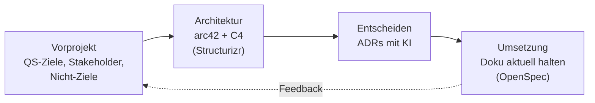
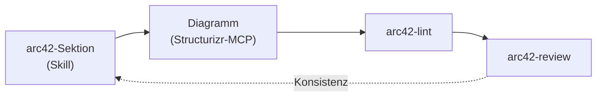
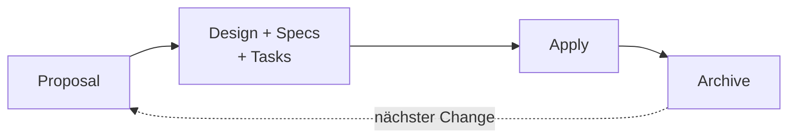

# Dokumentation mit KI

## TKuD · Tag 2

Mattias Fankhauser

<!--
Moderation: Datum ergänzen, sobald Tag 2 fixiert ist.
Rahmen: Gestern ging es darum, was gute Architekturdokumentation ausmacht. Heute legen wir eine KI-Schicht darüber.
-->

---
layout: agenda
---

# Agenda

- Dein IST- und Wunschstand
- Aus der Praxis
- Einordnung
- Vier Phasen mit KI
- Übung: Greenfield-Durchstich
- Transfer und Muster

<!--
Moderation: Ablauf laut Kapitel ca. 3:45 h plus Einstieg IST/Wunsch.
Erst Praxis, dann Theorie – bewusst so herum.
-->

---

# Dein IST- und Wunschstand

**10 Minuten · allein · schriftlich**

- **IST:** Wie dokumentierst du heute? Womit, wann, für wen?
- **Wunsch:** Wie willst du dokumentieren?
- Wo hilft dir KI heute schon – und wo nicht?

Wir sammeln alles und suchen am Ende gemeinsam nach Mustern.

<!--
Moderation: TKuD-Vorgabe – jede:r schreibt IST- und Wunschstand nieder, um später Muster zu finden.
OFFEN: Format (Karten, Board, Datei im Demo-Repo?) und wann genau die Muster ausgewertet werden. Aktuell: Auswertung im Transfer-Block am Ende.
-->

---
layout: section
---

# Aus der Praxis

## Brownfield: Doku aus bestehendem Code

---

# Projekt A: arc42 aus Legacy-Code

- **Ausgangslage:** _in Ausarbeitung_
- **KI-Einsatz:** _in Ausarbeitung_
- **Ergebnis:** _in Ausarbeitung_

<!--
Moderation: 15 min. Intern: Media Data. Auf den Folien anonymisiert (Entscheidung 16.10.).
TODO: Inhalte und anonymisierte Ausschnitte ergänzen.
-->

---

# Projekt B: Camel-Route-Guideline

- **Ausgangslage:** _in Ausarbeitung_
- **KI-Einsatz:** _in Ausarbeitung_
- **Ergebnis:** _in Ausarbeitung_

<!--
Moderation: 10 min. Intern: MM. Auf den Folien anonymisiert (Entscheidung 16.10.).
TODO: Inhalte und anonymisierte Ausschnitte ergänzen.
-->

---
layout: section
---

# Einordnung

## Phasen, Einstiege, Bausteine

---
layout: statement
---

# KI bringt keine neuen Konzepte. **Sie legt eine Schicht über das, was du gestern gelernt hast.**

<!--
Moderation: Sichten/C4, arc42, ADRs bleiben gleich. KI stellt Fragen, strukturiert, leitet ab, prüft – Entscheidungen bleiben bei uns.
Was rauskommt, ist nur so gut wie der Input und wird genauso kritisch gelesen wie menschliche Doku.
-->

---

# Vier Phasen



Jede Phase greift auf ein Kapitel von gestern zurück.

<!--
Moderation: Rückbezüge – Vorprojekt → Kreuztabelle (ADR-Kapitel), Architektur → Sichtenmodell und Notation, Entscheiden → ADR-Kapitel, Umsetzung → Docs-as-Code / Review-Prozess.
-->

---

# Zwei Einstiege

| | Greenfield | Brownfield |
|---|---|---|
| Quelle | Gespräche, Anforderungen, Ideen | Code, Konfiguration, Git-Historie |
| Rolle der KI | Sparringspartner: fragt nach | Analyst: leitet ab |
| Hauptrisiko | generisch, „alles ist wichtig“ | halluzinierte Zusammenhänge |
| ADRs | festhalten, während sie fallen | Gründe rekonstruieren |
| Heute | selbst gemacht (Übung) | gezeigt (Praxis) |

<!--
Moderation: Greenfield läuft Vorprojekt → Umsetzung, Brownfield startet bei der Umsetzung (Code als Quelle) und arbeitet sich zurück. Beide münden in denselben Zyklus: Doku aktuell halten.
-->

---
layout: quadrants
---

# Die Bausteine

::one::

### Agent
Junie oder Claude. Showcase und alle Übungen laufen damit.

::two::

### Skills
Wiederverwendbare Anleitungen für den Agenten, z. B. Brainstorming oder arc42-Sektionen.

::three::

### MCP-Server
Bindet externe Werkzeuge an, z. B. Structurizr zum Validieren und Rendern.

::four::

### Spec-driven
Spezifikation, Umsetzung und Doku entstehen in einem Zyklus.

<!--
Moderation: Konzepte sind werkzeugneutral – die Agenten sind ein Beispiel, keine Voraussetzung.
-->

---

# Vertraulichkeit

- Hands-on nur im vorbereiteten Demo-Repository
- Kein Kundencode, keine Kundendokumente in KI-Tools
- Transfer aufs eigene Projekt: als Diskussion

<!--
Moderation: Demo-Repo-URL einblenden, sobald sie feststeht (OFFEN).
-->

---
layout: section
---

# Phase 1

## Vorprojekt

---

# Die KI stellt die unbequemen Fragen

- Welche **Qualitätsziele** zählen wirklich? Top 3, nicht zehn.
- Woran messen wir die **nicht-funktionalen Anforderungen**?
- Wer sind die **Stakeholder** – und was brauchen sie von der Doku?
- Was bauen wir ausdrücklich **nicht**?

Werkzeug: **Brainstorming-Skill**

<!--
Moderation: 20 min inkl. Live-Demo Brainstorming-Skill am Demo-Projekt (nicht am Übungs-Brief).
Ergebnisse fließen in arc42-Sektion 1 und 2 und später in die Kreuztabelle.
-->

---
layout: section
---

# Phase 2

## Architektur

---

# arc42-Toolkit ins Repo holen

```text
/plugin marketplace add MSiccDev/arc42-toolkit
/plugin install arc42-toolkit@arc42-toolkit
```

- Ein Skill pro arc42-Sektion, fragt zuerst nach, statt zu erfinden
- Dazu `arc42-lint` und `arc42-review` zum Prüfen
- Junie: Skills unter `.junie/skills/`, im Demo-Repo schon verlinkt

<!--
Moderation: Befehle für Claude Code. Für Junie siehe documents/how-tos/junie-setup.md (Spike ki-junie-spike noch offen).
Team-Variante: Plugin per .claude/settings.json im Projekt festlegen.
-->

---

# Structurizr: Architektur als Code

```text
workspace {
  model {
    user = person "Nutzer:in"
    system = softwareSystem "Unser System"
    user -> system "nutzt"
  }
  views {
    systemContext system { include * }
  }
}
```

Über den **Structurizr-MCP** prüft und rendert der Agent die DSL selbst.

<!--
Moderation: Kurze allgemeine Vorstellung: ein Modell, mehrere Views; C4 von gestern.
MCP: https://mcp.structurizr.com/mcp, Tools validate / parse / export (PlantUML, Mermaid).
-->

---

# Orchestrierung: arc42-with-structurizr



Unser eigener Skill verbindet Text, Diagramm und Prüfung.

<!--
Moderation: Rückbezug Kapitel „Sichtenmodell und Notation“ – Konsistenz zwischen Sichten, Level of Detail.
-->

---
layout: section
---

# Phase 3

## Entscheiden

---
layout: two-cols-header
---

# ADRs mit KI

::left::

### Greenfield
- Entscheidung festhalten, während sie fällt
- Optionen und Konsequenzen einfordern
- Bezug zu einem Qualitätsziel

::right::

### Brownfield
- „Warum ist das so?“ aus Code und Historie
- Gründe rekonstruieren, nicht erfinden
- Annahmen sichtbar markieren

::bottom::

Format wie gestern: MADR. Verknüpfung über die Kreuztabelle.

<!--
Moderation: 15 min. Rückbezug ADR-Kapitel (MADR, Kreuztabelle QS ↔ Entscheidungen).
-->

---
layout: section
---

# Phase 4

## Umsetzung

---

# Doku aktuell halten



- Doku wird bei jeder Änderung mitgezogen, nicht nachträglich repariert
- OpenSpec als Beispiel für Spec-driven Development
- Proposal, Design und Archiv wirken wie ein ADR-Log

<!--
Moderation: 10 min, keine eigene Phase. Kurze Demo eines Changes aus dem Trainings-Repo von Proposal bis Archiv.
Rückbezug: Docs-as-Code, ADR-Workflow, Review-Prozess.
-->

---
layout: section
---

# Übung

## Greenfield-Durchstich

---
class: gepardec-text-sm
---

# Greenfield-Durchstich

**Teams à 3–4 · 90 Minuten · Demo-Repo · Junie oder Claude**

| # | Schritt | Dauer |
|---|---|---|
| 1 | Brainstorming: Top-3-Qualitätsziele, Stakeholder, Nicht-Ziele | 30 min |
| 2 | arc42-Sektion 1 und 2 | 15 min |
| 3 | Kontextdiagramm mit Structurizr | 20 min |
| 4 | Ein ADR mit Bezug zu einem Qualitätsziel | 15 min |
| 5 | Teamvergleich | 10 min |

<!--
Moderation: Grundlage ist ein fiktiver Kunden-Brief mit Lücken, Widersprüchen und versteckten Zielkonflikten.
OFFEN: Domäne des Kunden-Briefs.
-->

---
layout: statement
---

# Gleicher Brief, andere Qualitätsziele. **Qualitätsziele sind Entscheidungen, keine Ableitungen.**

<!--
Moderation: Im Teamvergleich zeigen – wer die KI nur generieren lässt, landet bei generischen Ergebnissen.
-->

---

# Transfer aufs eigene Projekt

- Zurück zu deinem IST- und Wunschstand: **Welche Muster sehen wir?**
- Brownfield oder Greenfield?
- Welche Phase hat den größten Nachholbedarf?
- Welcher Skill würde dir am meisten bringen?
- Wie passt das zu den Vorgaben im Projekt, z. B. einem Systemarchitekturkonzept?

<!--
Moderation: 20 min, als Diskussion – nicht live mit Kundencode. Umsetzung im Projekt erst nach Abstimmung mit Projekt bzw. Kunden.
-->

---
layout: contact
name: Mattias Fankhauser
role: Software Architekt
email: mattias.fankhauser@gepardec.com
phone: +43 664 1869 512
photo: /contact_mfankhauser.jpg
---

# Danke!
