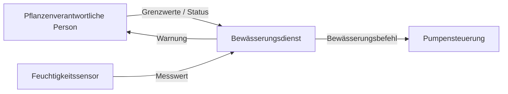

<h1 style="font-size: 2.8rem">Technische Kommunikation und Dokumentation</h1>

### Softwarearchitektur verständlich festhalten – mit arc42

Ein Praxistag für Softwareentwickler:innen und Softwarearchitekt:innen

<!--
Moderation: Begrüßen, kurz den Rahmen setzen. Arbeitsannahme für diesen Deck-Entwurf: Training 09:00–17:00, gemischte Vorkenntnisse, Kleingruppenarbeit.
-->

---

# Heute arbeiten wir an einer Frage

> Wie halten wir Architektur so fest, dass sie Menschen bei ihrer Arbeit hilft?

- verständlich für die jeweilige Zielgruppe
- angemessen im Umfang
- mit der Entwicklung verbunden

<!--
Moderation: Die Frage den ganzen Tag sichtbar halten. Keine Definitionen vorwegnehmen; erst Erwartungen einsammeln.
-->

---

# Unser Tagesziel

Am Ende kannst du …

- Informationsbedürfnisse in Dokumentation übersetzen
- arc42 passend zuschneiden
- sinnvolle Sichten und Diagramme wählen
- Entscheidungen und Konzepte nachvollziehbar festhalten
- Pflege und Review im Team verankern

---

# Tagesablauf

| Zeit | Schwerpunkt |
|---|---|
| Vormittag | Warum, für wen, Qualitätsziele, arc42 |
| Früher Nachmittag | Sichten und Diagramme |
| Später Nachmittag | ADRs, Konzepte, Werkzeuge, Reviews und Transfer |

Pausen: 10:15 · 12:30 Mittag · 14:15 · 15:55

<!--
Moderation: Zeiten als Entwurf nennen. Tagesplan umfasst 09:00 bis 17:00.
-->

---

# Einstieg: Montagmorgen

Ein neues Teammitglied soll nächste Woche an unserem System mitarbeiten.

**Welche drei Fragen wird es wahrscheinlich stellen?**

2 Minuten allein · 5 Minuten zu zweit · sammeln im Plenum

<!--
Übung, 8 Minuten. Fragen auf Karten sammeln. Typische Beispiele: Was macht das System? Wo ändere ich etwas? Wie hängen die Teile zusammen? Warum wurde es so entschieden?
-->

---

# Vier vertraute Antworten

- „Steht alles im Wiki!“
- „Wir gehen agil vor.“
- „Das war schon so, als ich neu war.“
- „Das ist historisch gewachsen.“

**Welche Frage bleibt damit unbeantwortet?**

<!--
Moderation: Stefan Zörners vier exemplarische Antworten aus Kapitel 1.1.2 sinngemäß/kurz wiedergeben. Nicht als Schuldzuweisung, sondern als Einstieg in fehlende oder unauffindbare Architekturinformationen.
-->

---

# Der Fall für heute

## Automatische Pflanzenbewässerung

Ein Sensor misst die Bodenfeuchtigkeit. Ein Dienst bewertet den Messwert und kann eine Pumpe ansteuern. Eine Person konfiguriert Grenzwerte und sieht Status oder Warnungen.

**Einfach zu verstehen. Reich an Architekturfragen.**

<!--
Wichtig: Hogarama inspiriert den Anwendungsfall. Unser Trainingssystem ist fiktiv und beschreibt nicht die reale Hogarama-Architektur.
-->

---

# Unser bewusst einfaches Systemmodell



**Technologien und interne Bausteine legen wir für Übungen fest.**

---

# Arbeitsregel für Annahmen

Wenn uns ein Detail fehlt:

1. eine plausible Annahme treffen
2. sie sichtbar markieren
3. prüfen, welche Entscheidung davon abhängt

**Wir lernen Dokumentation – keine Hogarama-Archäologie.**

<!--
Moderation: Entlastet die Gruppe vom Drang, reale Implementierungsdetails zu kennen. Details bleiben absichtlich offen, bis eine Übung sie benötigt.
-->

---

# Warum dokumentieren?

Architekturdokumentation kann helfen, …

- Architektur gemeinsam zu erarbeiten
- die Lösung nachvollziehbar und bewertbar zu machen
- Umsetzung und Weiterentwicklung zu leiten

Sie ist Kommunikationsmittel und Arbeitsgrundlage.

<!--
Moderation: Drei Ziele nach Zörner knapp erläutern. Fragen, wo diese im eigenen Alltag sichtbar werden.
-->

---

# Übung: Gute Antwort statt Folklore

Wählt eine Frage des neuen Teammitglieds.

1. Wer stellt sie?
2. Welche Arbeit soll die Antwort ermöglichen?
3. Was ist die kleinste hilfreiche Dokumentation?

**12 Minuten in Kleingruppen, danach vergleichen.**

<!--
Übung 15 Minuten inkl. kurzer Auswertung. Erinnerung: Manches braucht ein Gespräch, anderes eine dauerhaft auffindbare Erklärung. Dokumentation soll nicht jede Kommunikation ersetzen.
-->

---

# Dokumentation: angemessen statt maximal

- **Nützlich:** beantwortet eine konkrete Frage
- **Aktuell:** Änderungen erreichen die Doku
- **Verständlich:** Begriffe und Detailgrad passen zur Zielgruppe
- **Sparsam:** nur so viel wie für Zweck und Risiko nötig

---

# Für wen dokumentieren wir?

| Stakeholder | Typisches Anliegen |
|---|---|
| Pflanzenverantwortliche Person | Wird rechtzeitig und nicht zu viel gegossen? |
| Entwicklungsteam | Wo ergänze ich eine Sensorart? |
| Betrieb | Was passiert bei Geräte- oder Netzausfall? |
| Produktverantwortung | Welche Fähigkeiten und Grenzen hat das System? |

---

# Übung: Stakeholder-Mapping

Ergänzt für euren Fall:

- Wer stellt Fragen an die Architektur?
- Was muss diese Person entscheiden oder erledigen?
- Welche Information hilft dabei?

**15 Minuten · Ergebnis: eine Stakeholder-Matrix**

<!--
Moderation: Gruppen à 3–5 Personen. Bestehende Tabelle als Startpunkt, nicht als vollständige Liste. Bei Bedarf Betrieb, Sicherheit, Support und Datenschutz ergänzen.
-->

---

# Von „zuverlässig“ zu überprüfbar

Ein Qualitätsziel wird nützlicher, wenn es ein beobachtbares Verhalten beschreibt.

> Wenn der Sensor drei Messintervalle ausfällt, wird nicht automatisch gegossen und innerhalb von fünf Minuten eine Warnung angezeigt.

Auslöser · Kontext · Reaktion · Maßstab

---

# Q42 und ISO 25010

- **Q42:** pragmatisches Qualitätsmodell mit Merkmalen und Beispielen
- **ISO/IEC 25010:** Standard für Qualitätsmodelle und Qualitätsmerkmale
- Beide können helfen, Bedürfnisse zu strukturieren
- Ein Qualitätsziel braucht trotzdem einen konkreten Kontext und Maßstab

<!--
Moderation: Klarstellen, dass Q42 keine ISO-Norm ist. Nicht in Qualitätsmodell-Details abgleiten; Fokus auf greifbare Szenarien.
-->

---

# Übung: Qualitätsszenario

Wählt ein Qualitätsbedürfnis, etwa:

- keine Überbewässerung
- nachvollziehbarer Status
- Verhalten bei Geräteausfall

Formuliert Auslöser, Kontext, erwartete Reaktion und Messkriterium.

**20 Minuten · anschließend: Welche Architekturentscheidung beeinflusst das?**

<!--
Moderation: Beispiel nur als Starthilfe. Maßzahlen dürfen als Trainingsannahmen erfunden werden, müssen aber als solche markiert sein.
-->

---

# arc42: ein gemeinsames Inhaltsgerüst

12 Abschnitte – flexibel anpassbar

1. Einführung und Ziele · 2. Randbedingungen · 3. Kontext
4. Lösungsstrategie · 5. Bausteine · 6. Laufzeit
7. Verteilung · 8. Querschnittliche Konzepte · 9. Entscheidungen
10. Qualitätsanforderungen · 11. Risiken und technische Schulden · 12. Glossar

---

# arc42 hilft bei zwei Fragen

## Was sollten wir festhalten?

## Wie können wir es verständlich kommunizieren?

Die Abschnitte geben Orientierung. Der Umfang folgt Stakeholdern, Fragen und Risiken.

<!--
Moderation: arc42 ist ein Template, kein Dokumentationsprojekt mit Vollständigkeitszwang. Zeige, dass Abschnitte leer, knapp, verlinkt oder vertieft sein können.
-->

---

# Übung: Was gehört wohin?

Ordnet Informationskarten den arc42-Abschnitten zu:

- Qualitätsziel · externe Schnittstelle · Laufzeitablauf
- Technologiezwang · Modulverantwortung · Deployment
- Bewässerungsregel · ADR · Ausfallrisiko · Fachbegriff

**20 Minuten · Mehrfachbezüge markieren**

<!--
Moderation: Eine Information bekommt einen führenden Ablageort. Andere Stellen können darauf verweisen. Diskutiert strittige Zuordnungen anhand des Leserbedarfs.
-->

---

# Übung: Schlankes arc42-Gerüst

Welche Abschnitte brauchen wir zuerst, um diese Frage zu beantworten?

> „Was passiert, wenn keine aktuellen Messwerte verfügbar sind?“

Priorisiert drei Abschnitte und begründet die Auswahl.

<!--
Übung 15 Minuten. Erwartbar: Kontext (Systemgrenze), Laufzeit (Fehlerpfad), Querschnittskonzept (Datenalter/Fehlerbehandlung), Qualitätsanforderungen, ggf. ADR/Risiken. Mehrere Antworten sind plausibel.
-->

---

# Nach der Pause: Sichten

Eine Architektur hat viele Anliegen.

Eine Sicht zeigt die Aspekte, die für eine konkrete Frage wichtig sind.

**Welche Frage soll dieses Diagramm beantworten?**

---

# Vier nützliche Sichten im Fall

| Sicht | Beispielhafte Frage |
|---|---|
| Kontext | Welche Nutzer:innen und Nachbarsysteme gibt es? |
| Bausteine | Welche Verantwortlichkeiten und Abhängigkeiten hat der Dienst? |
| Laufzeit | Wie wird aus einem Messwert ein Pumpenbefehl? |
| Verteilung | Wo laufen Dienst, Speicherung und Geräte? |

---

# Notation dient der Verständigung

- **C4:** Kontext und Bausteine verständlich strukturieren
- **UML:** unter anderem Komponenten- und Sequenzdiagramme
- **BPMN:** Geschäftsabläufe mit fachlichen Rollen und Schritten
- **Text/Tabellen:** oft passend für Regeln, Schnittstellen und Konsequenzen

Wählt die einfachste Notation, die die Frage beantwortet.

---

# ISO/IEC/IEEE 42010 in einem Satz

Ein Rahmen für Architekturbeschreibungen, Stakeholder-Anliegen, Sichten und Viewpoints.

**Sie schreibt nicht vor, ob wir C4, UML, BPMN oder ein bestimmtes Tool verwenden.**

<!--
Moderation: Die Norm begrifflich einordnen, nicht als Diagrammstandard oder arc42-Konkurrent darstellen. Version hier: 2022.
-->

---

# Ein Diagramm braucht einen Zweck

Vor dem Zeichnen klären:

1. Für wen ist die Sicht?
2. Welche Frage beantwortet sie?
3. Was lassen wir bewusst weg?
4. Wie genau muss sie für diese Entscheidung sein?

---

# Übung 1: Systemkontext

Zeichnet die Systemgrenze und die Nachbarn:

- Pflanzenverantwortliche Person
- Feuchtigkeitssensor
- Bewässerungsdienst
- Pumpensteuerung
- optional: Benachrichtigungsdienst

**15 Minuten · Beziehungen beschriften · Annahmen markieren**

<!--
Moderation: Keine Technologie vorgeben. Diagramm kann auf Papier entstehen. Achtet auf klare Grenze und verständliche Beziehungen.
-->

---

# Übung 2: Laufzeit

Modelliert den Ablauf:

> Messwert kommt an → Entscheidung wird getroffen → Pumpe erhält Befehl → Status wird sichtbar

Ergänzt danach den Fehlerfall „Messwert fehlt“.

**15 Minuten · danach Peer-Review**

---

# Peer-Review: Kann ich die Frage beantworten?

- Was gehört zum System, was liegt außerhalb?
- Welche Komponente trifft die Bewässerungsentscheidung?
- Was passiert bei fehlenden Messwerten?
- Welche Annahme oder Beziehung bleibt unklar?

<!--
Moderation: Gruppen tauschen Skizzen. Feedback beobachtbar und konkret formulieren. Nicht die Diagrammkunst bewerten.
-->

---

# Konsistenz zwischen Sichten

Begriffe und Verantwortlichkeiten sollten zusammenpassen.

- Kontext zeigt die richtigen Nachbarn
- Bausteine passen zur Systemgrenze
- Laufzeit nutzt existierende Verantwortlichkeiten
- Deployment ordnet die Bausteine einer Umgebung zu

**Änderungen an einer Sicht können andere Sichten betreffen.**

---

# Architekturentscheidungen: Warum festhalten?

Eine Entscheidung ohne Kontext wird später leicht missverstanden.

Ein ADR hält fest:

- welches Problem vorlag
- welche Optionen betrachtet wurden
- was entschieden wurde und warum
- welche Folgen und Risiken erwartet werden

---

# ADR: ein schlankes Format

```text
Titel und Status
Kontext / Problem
Entscheidung
Betrachtete Alternativen
Konsequenzen
Bezüge: Qualitätsziele, Risiken, andere ADRs
```

Nicht jede Kleinigkeit braucht ein ADR. Dokumentiert Entscheidungen mit spürbarer Wirkung.

---

# Übung: Schreibt ein ADR

Wählt eine offene Frage:

- lokal oder zentral entscheiden bei Netzausfall?
- wie doppelte Pumpenbefehle verhindern?
- wie eine neue Sensorart integrieren?

Schreibt Kontext, Optionen, Entscheidung und Konsequenzen.

**20 Minuten · danach gegenseitig reviewen**

<!--
Moderation: Das Ergebnis darf eine Trainingsentscheidung sein. Bewertet Nachvollziehbarkeit und Folgen, nicht ob die Gruppe dieselbe Architektur wählt wie ihr.
-->

---

# Verknüpft Entscheidung und Qualität

Eine gute Begründung verweist auf das Ziel.

**Qualitätsziel:** bei Sensorausfall nicht versehentlich bewässern  
**Entscheidung:** ohne frische Messung keine automatische Aktivierung  
**Folge:** Pflanzenverantwortliche müssen bei Ausfall informiert werden  
**Risiko:** Fehlalarm bei kurzzeitigen Funkstörungen

---

# Querschnittliche Konzepte

Themen, die mehrere Bausteine betreffen:

- Fehlerbehandlung und Wiederholungen
- Logging und Beobachtbarkeit
- Sicherheit und Berechtigungen
- Teststrategie
- Technologie- und Schnittstellenregeln

Ein Konzept erklärt, **wie** wir solche Regeln im System anwenden.

---

# Konzept erklären: vom Prinzip zum Beispiel

Eine hilfreiche Konzeptseite enthält:

1. Zweck und betroffene Bausteine
2. Regel oder Ablauf
3. Beispiel aus dem konkreten Fall
4. Fehlerfall und Ausnahme
5. Bezug zu Qualitätsziel oder ADR

---

# Übung: Ein Konzept für den Alltag

Wählt ein Thema, etwa:

- Umgang mit veralteten Sensordaten
- Logging eines Bewässerungsvorgangs
- Testen der Pumpensteuerung ohne echte Pumpe

Erstellt eine Konzeptseite mit Ablauf, Beispiel und Fehlerfall.

**20 Minuten · Galeriegang mit Peer-Feedback**

<!--
Moderation: Bitte knapp bleiben. Ziel ist, dass eine andere Gruppe das Konzept anwenden kann. Pro Gruppe ein positives Signal und eine offene Frage sammeln.
-->

---

# Werkzeuge: Quelle und Ausgabe unterscheiden

| Zweck | Mögliche Mittel |
|---|---|
| Text und Review | Markdown, Confluence |
| Diagrammquellen | PlantUML, Draw.io |
| Schnittstellenvertrag | OpenAPI |
| Veröffentlichung / Prüfungen | CI/CD-Pipeline |

Das Werkzeug löst nicht von selbst Fragen zu Zuständigkeit und Aktualität.

---

# Was kann CI/CD unterstützen?

- Links und Format prüfen
- Diagrammquellen rendern
- OpenAPI-Dokumentation generieren
- Änderungen gemeinsam mit Code reviewen
- veröffentlichte Dokumentation bereitstellen

Automatisierung prüft Struktur. Menschen prüfen Bedeutung und Verständlichkeit.

---

# Qualität und Zuständigkeit

Für jede Information sollte klar sein:

- wo die maßgebliche Fassung liegt
- wer Änderungen einpflegt
- welches Ereignis ein Review auslöst
- was automatisch prüfbar ist

Architekturänderung und Dokumentationsänderung gehören in denselben Arbeitsfluss.

---

# Übung: Mini-Review und Pflegevereinbarung

Prüft ein Artefakt einer anderen Gruppe:

- angemessen und verständlich?
- aktuell und widerspruchsfrei?
- auffindbar und mit Zweck versehen?

Vereinbart danach: Quelle, Zuständigkeit, Review-Auslöser.

**15 Minuten**

<!--
Moderation: Die fünf Kriterien an der Wand lassen. Zum Beispiel fachliche Änderung, neues Risiko oder Release als Review-Auslöser. Eine Rolle/ein Team benennen, nicht „alle“.
-->

---

# Was heute entstanden ist

- Stakeholder-Fragen
- Qualitätsszenario
- zugeschnittenes arc42-Gerüst
- Kontext- und Laufzeitsicht
- ADR
- querschnittliches Konzept
- Review- und Pflegevereinbarung

**Ein zusammenhängendes, kleines Architekturpaket.**

---

# Transfer: Was nimmst du mit?

Beende den Satz:

> In meinem nächsten Projekt werde ich die Frage **…** für **…** mit **…** dokumentieren.

**Ein persönlicher nächster Schritt.**

<!--
Moderation: Runde; Antworten kurz halten. Eine konkrete Frage und ein Artefakt nennen lassen, nicht nur „mehr dokumentieren“.
-->

---

# Drei Gedanken zum Mitnehmen

1. Dokumentation beginnt bei den Fragen der Menschen.
2. arc42 ist ein anpassbares Gerüst, kein Vollständigkeitswettbewerb.
3. Eine gute Doku wird mit der Architektur gepflegt und überprüft.

---

# Quellen und weiterführende Links

- [arc42 – Überblick und zwölf Abschnitte](https://arc42.org/overview/)
- [arc42-Dokumentation](https://docs.arc42.org/)
- [Q42-Qualitätsmodell](https://quality.arc42.org/articles/arc42-quality-model)
- [ISO/IEC/IEEE 42010:2022](https://www.iso.org/standard/74393.html)
- [Stefan Zörner, Kapitel 1.1.2 – Leseprobe](https://api.pageplace.de/preview/DT0400.9783446472464_A42831971/preview-9783446472464_A42831971.pdf)
- [Gepardec: Hogarama](https://www.gepardec.com/blog/hogarama/)

<!--
Quellenhinweis: Hogarama ist Inspiration für den Anwendungsfall Pflanzenbewässerung. Systemmodell und Architekturentscheidungen in diesem Training sind fiktiv.
-->
